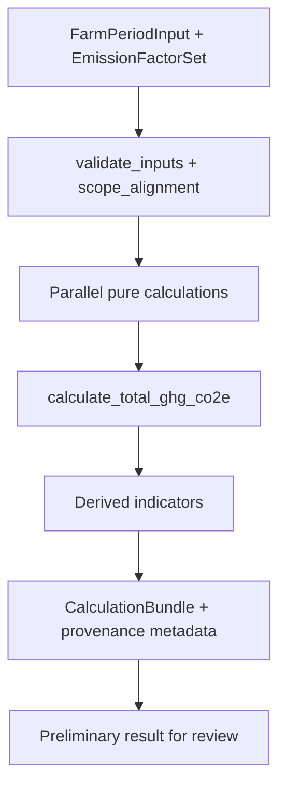

# Revisão Técnica do Projeto de Cálculos

**Repositório:** `agrotrace-carbon-calculation-service`  
**Pacote:** `ecofarm-calculations` v0.2.0  
**Data da revisão:** 10 de junho de 2026  
**Escopo:** camada de cálculos ambientais/agropecuários para emissões na pecuária leiteira

---

## 1. Visão geral do projeto

### 1.1 Propósito e posição no ecossistema Agrotrace

O repositório analisado é uma **biblioteca Python de cálculo de emissões de GEE**, não um serviço completo de pipeline. Seu papel no ecossistema Agrotrace é executar a etapa **cálculos → resultado preliminar**, recebendo dados já validados e produzindo massas de gases e CO2e agregado.

O pipeline alvo descrito pelo projeto é:

```
dado bruto → wrapper → dado normalizado → modelo canônico/ontologia
→ inferências/validações semânticas → CÁLCULOS → resultado preliminar
→ aprovação humana → publicação final → proveniência → hash/ancoragem
```

**Neste repositório existem apenas:**
- Funções puras de cálculo (`emissions/`)
- Orquestração CSV/DataFrame (`batch_runner.py`)
- Compatibilidade com API legada (`environmental_calcs.py`)

**Não existem neste repositório:** API HTTP, banco de dados, ontologia, validação semântica, aprovação humana, proveniência ou ancoragem blockchain. Essas capacidades estão parcialmente modeladas no sibling `agrotrace-carbon-traceability-service` (`CalculationMethodVersion`, `CalculationResultSet`, `CalculationResultAggregationLink`, etc.), mas **ainda não há integração de código** com esta biblioteca.

### 1.2 Integração externa atual

O ponto de integração operacional é um pipeline CSV:

| Direção | Caminho | Papel |
|---------|---------|-------|
| Entrada | `../../data/processed/validated_data.csv` | Dados pós-validação upstream |
| Saída | `../../data/processed/calculate_data.csv` | Resultados preliminares downstream |

Referência: `environmental_calcs.py` (`__main__`) e `batch_runner.run_csv_pipeline`.

### 1.3 Stack técnico

| Componente | Tecnologia |
|------------|------------|
| Linguagem | Python ≥ 3.10 |
| Dependência runtime | pandas ≥ 2.0 (somente orquestração CSV) |
| Testes | pytest ≥ 7.0 (22 testes em 4 módulos) |
| Padrões | dataclasses, enums, funções puras, injeção de parâmetros |
| Referências metodológicas citadas | IPCC 2006 (Vol. 2, Vol. 4), GWP IPCC AR4 |

### 1.4 Arquitetura em camadas

```
┌─────────────────────────────────────────────────────────────┐
│  environmental_calcs.py  │  batch_runner.py               │
│  (legacy wrappers + CLI) │  (CSV/DataFrame orchestration)   │
└──────────────────────────┴────────────────────────────────┘
                              │
                              ▼
┌─────────────────────────────────────────────────────────────┐
│  emissions/  — camada pura                                 │
│  enteric_fermentation │ manure_management │ fertilizer     │
│  energy │ ghg_total │ validators │ models │ temporal_scope │
│  defaults │ conversion_helpers                             │
└─────────────────────────────────────────────────────────────┘
```

A refatoração documentada em `REFACTORING.md` migrou um monolito (`environmental_calcs.py` original) para esta arquitetura em três camadas, com divergência intencional e documentada no cálculo de manejo de esterco (multiplicação por `days_in_period`).

### 1.5 Cobertura funcional resumida

| Domínio de emissão | Implementado | Tier metodológico |
|--------------------|--------------|-------------------|
| Fermentação entérica (CH4) | Sim | Tier 1 simplificado por categoria |
| Manejo de dejetos (CH4) | Sim | Proxy massa de esterco × EF |
| Fertilizante N inorgânico (N2O) | Sim | Direto + indireto (volatilização) |
| Energia fóssil/elétrica (CO2) | Sim | Fatores por vetor |
| Total CO2e (GWP) | Sim | AR4 default injetável |
| Intensidade por litro de leite | **Não** | — |
| Alocação leite/coproduto | **Não** | — |
| Consolidação mensal → anual auditável | **Parcial** (helper manual) | — |
| Remoções/sequestro | **Não** | — |
| Incerteza | **Não** | — |

---

## 2. Inventário dos módulos e funções

### 2.1 Árvore de arquivos

```
agrotrace-carbon-calculation-service/
├── pyproject.toml
├── REFACTORING.md
├── environmental_calcs.py          # Legacy + CLI
├── batch_runner.py                 # Orquestração CSV
├── emissions/
│   ├── __init__.py                 # API pública
│   ├── models.py                   # CalculationResult, TotalGhgResult
│   ├── exceptions.py               # CalculationError, TemporalInconsistencyError
│   ├── temporal_scope.py           # TemporalScope, normalização
│   ├── validators.py               # Validações reutilizáveis
│   ├── defaults.py                 # Fatores default + extractors CSV
│   ├── conversion_helpers.py       # Prorratação/soma temporal explícita
│   ├── enteric_fermentation.py
│   ├── manure_management.py
│   ├── fertilizer.py
│   ├── energy.py
│   └── ghg_total.py
└── tests/
    ├── conftest.py
    ├── test_enteric_and_manure.py
    ├── test_fertilizer_energy_total.py
    ├── test_temporal_scope.py
    └── test_conversion_and_compat.py
```

### 2.2 Módulos de cálculo puro (`emissions/`)

| Arquivo | Funções exportadas | Natureza |
|---------|-------------------|----------|
| `enteric_fermentation.py` | `calculate_enteric_fermentation_ch4` | Computacional pura |
| `manure_management.py` | `calculate_manure_management_ch4` | Computacional pura |
| `fertilizer.py` | `calculate_fertilizer_n2o` | Computacional pura |
| `energy.py` | `calculate_energy_co2` | Computacional pura |
| `ghg_total.py` | `calculate_total_ghg_co2e` | Agregação pura |
| `conversion_helpers.py` | `uniform_monthly_from_yearly_per_animal`, `sum_monthly_values` | Utilitário temporal |
| `temporal_scope.py` | `normalize_temporal_label`, `require_matching_scope` | Contrato temporal |
| `validators.py` | 5 funções de validação | Pré-condições |
| `defaults.py` | 6 funções de fatores + 3 extractors | Configuração + parsing |
| `models.py` | `CalculationResult`, `TotalGhgResult` | DTOs de saída |

### 2.3 Camada de orquestração (acoplada a infra)

| Arquivo | Funções | Acoplamento |
|---------|---------|-------------|
| `batch_runner.py` | `compute_row_results`, `add_emissions_columns`, `run_csv_pipeline` | pandas, CSV, colunas fixas |
| `environmental_calcs.py` | `calculate_enteric_fermentation`, `calculate_manure_management`, `calculate_fertilizer_emissions`, `calculate_energy_emissions`, `calculate_total_emissions`, `_default_days_in_period` | dict legado, paths hardcoded no `__main__` |

### 2.4 Grafo de dependências entre cálculos

```
farm_data / CSV row
│
├── extract_headcounts ──────────────────► calculate_enteric_fermentation_ch4 ──┐
├── extract_body_weights_kg ──┐                                                │
├── extract_headcounts ───────┼──► calculate_manure_management_ch4 ───────────┤
│   (+ manure EFs, days_in_period)                                               │
├── Non_Organic_Fertilizer ───► calculate_fertilizer_n2o ───────────────────────┤
├── extract_energy_consumption ► calculate_energy_co2 ──────────────────────────┤
│                                                                                │
│   gwp_ipcc_ar4() ou GWP injetado ────────────────────────────────────────────┤
│                                                                                ▼
└──────────────────────────────────────────────────────────► calculate_total_ghg_co2e

Opcionais (não encadeados automaticamente):
  uniform_monthly_from_yearly_per_animal  →  prorratação de EF enteric
  sum_monthly_values                      →  soma de 12 valores mensais
```

### 2.5 Inputs esperados (contrato CSV implícito)

**Categorias animais** (`ANIMAL_CATEGORIES`):
- `Lactating_Cows`, `Dry_Cows`, `Heifers`, `Calves`, `Bulls`

**Pesos:** `{Categoria}_Weight` (kg)

**Fertilizante:** `Non_Organic_Fertilizer` (interpretado como kg N aplicado — sem validação explícita)

**Energia** (`ENERGY_VECTORS`):
- `Diesel`, `Gasoline`, `Electricity_Grid`, `Photovoltaic_Energy`

**Outputs gerados** (`batch_runner.compute_row_results`):
- `ch4_enteric_kg`, `ch4_manure_kg`, `n2o_fertilizer_kg`, `co2_energy_kg`
- `co2e_total_kg`, `co2e_ch4_portion_kg`, `co2e_n2o_portion_kg`, `co2_energy_portion_kg`

### 2.6 O que é puramente computacional vs acoplado

| Puramente computacional | Acoplado a parsing/infra |
|-------------------------|--------------------------|
| `calculate_*_ch4`, `calculate_*_n2o`, `calculate_*_co2`, `calculate_total_ghg_co2e` | `extract_*` em `defaults.py` |
| `validators.*`, `conversion_helpers.*` | `batch_runner.*` |
| `require_matching_scope`, `normalize_temporal_label` | `environmental_calcs.*` (dict shape legado) |
| | `run_csv_pipeline` (I/O, separador `;`) |

---

## 3. Pontos fortes

### 3.1 Arquitetura e engenharia de software

1. **Separação clara pure/impure:** as fórmulas nucleares em `emissions/` não importam pandas, não leem arquivos e não aplicam defaults internamente. Isso facilita teste, composição e futura integração com o traceability-service.

2. **Refatoração documentada:** `REFACTORING.md` registra hardcodes removidos, divergências intencionais (manure × days) e pontos de atenção — raro e valioso em projetos de cálculo científico.

3. **Contratos de saída ricos:** `CalculationResult` carrega `value`, `unit`, `temporal_scope` e `description`. `TotalGhgResult` decompõe CO2e por gás convertido. Isso é base sólida para proveniência e auditoria.

4. **Injeção explícita de parâmetros:** GWP, fatores de emissão e frações são parâmetros do chamador, não constantes escondidas. Testes validam isso explicitamente (`test_fertilizer_yearly_explicit_fraction_parameter`).

5. **Validações na camada pura:** alinhamento de chaves, não-negatividade, finitude, consistência de unidades no total CO2e, e validação de `days_in_period` vs escopo temporal para manejo de esterco.

6. **Escopo temporal como first-class concept:** `TemporalScope.MONTHLY | YEARLY` com aliases em português/inglês e `require_matching_scope` no agregador.

7. **Correção metodológica importante:** o bug legado de manejo de esterco (fatores diários sem multiplicação por dias) foi corrigido e testado — aumenta integridade física das unidades.

8. **Testes de fórmula sólidos:** 22 testes cobrem happy paths, key mismatch, limites temporais de dias, GWP explícito e compatibilidade parcial com wrapper legado.

### 3.2 Aderência parcial ao domínio

- Categorias animais relevantes para leite (vacas lactantes, secas, novilhas, bezerros, touros).
- Quatro fontes clássicas de emissão on-farm presentes (enteric, manure, fertilizer, energy).
- Vetores energéticos típicos de propriedade rural (diesel, gasolina, rede, fotovoltaico).

---

## 4. Problemas encontrados

### 4.1 Problemas técnicos

| ID | Problema | Localização | Severidade |
|----|----------|-------------|------------|
| T1 | Duplicação de orquestração entre `batch_runner.py` e `environmental_calcs.py` | Ambos montam os mesmos 5 cálculos com lógica quase idêntica | Média |
| T2 | API legada retorna `float` — descarta `unit`, `temporal_scope`, `description` | `environmental_calcs.calculate_*` | Média |
| T3 | Extractors usam `row[key]` direto → `KeyError` em vez de `CalculationError` | `defaults.extract_*` | Média |
| T4 | `batch_runner` não valida chaves de `gwp` ou `fertilizer_factors` antes de acesso | `batch_runner.py:87-89, 102-103` | Média |
| T5 | Validação de unidades por comparação de string literal (`"kg CH4"`) — frágil | `ghg_total.py:43-52` | Baixa |
| T6 | `require_non_negative` não rejeita `NaN` explicitamente (passa check `< 0`) | `validators.py:15-30` | Baixa |
| T7 | Sem testes para `batch_runner`, extractors, validators isolados | `tests/` | Alta |
| T8 | Sem fixtures CSV de integração | ausente | Média |
| T9 | `defaults.py` mistura registro de fatores com extractors de linha CSV | SRP violado levemente | Baixa |
| T10 | Nomenclatura inconsistente: `Non_Organic_Fertilizer` sugere massa de produto, código trata como kg N | `batch_runner.py:86` | Média |

### 4.2 Problemas de domínio e modelagem

| ID | Problema | Impacto |
|----|----------|---------|
| D1 | Fatores default são "didáticos/legado", não IPCC Tier 2 para dairy | Resultados não auditáveis metodologicamente |
| D2 | Enteric: flat kg CH4/animal — ignora dieta, Ym, produção de leite, peso metabólico | Subestima/sobreestima por perfil produtivo |
| D3 | Manure: proxy `n × w × md × ef × days` — sem VS, B0, MCF, sistema de armazenamento, temperatura | Não diferencia biodigestor vs lagoa vs pastoreio |
| D4 | Fertilizer: só indireto por volatilização — falta rota leaching/runoff (IPCC Eq. 11.2) | Subestima N2O indireto |
| D5 | Sem CO2 de ureia/calcário | Gap IPCC Vol. 4 |
| D6 | Sem fertilizante orgânico / dejetos aplicados ao solo | Gap comum em fazendas leiteiras |
| D7 | Sem produção de leite nos inputs | Impossível calcular indicador central do setor lácteo |
| D8 | Sem alocação entre leite e coprodutos (carne, bezerros vendidos) | Total de fazenda ≠ intensidade láctea |
| D9 | GWP fixo AR4 (CH4=25, N2O=298) — sem opção AR5/AR6 documentada | Desalinhamento com reportes recentes |
| D10 | Sem separação emissão vs remoção | Incompatível com reporte moderno de carbono |

### 4.3 Problemas de extensibilidade e rastreabilidade

| ID | Problema | Impacto no pipeline alvo |
|----|----------|--------------------------|
| R1 | Sem `method_code`, `formula_hash`, `implementation_version` | Não encaixa no modelo `CalculationMethodVersion` do traceability-service |
| R2 | Sem `CalculationResultItem` mapping tipado | Integração manual com proveniência |
| R3 | Sem consolidador auditável mensal→anual com metadados de agregação | Não popula `CalculationResultAggregationLink` |
| R4 | Colunas de saída renomeadas vs legado sem adapter | Quebra consumidores downstream (`REFACTORING.md` §3.4) |

### 4.4 Duplicação e coesão

- A lógica de `compute_row_results` e `calculate_total_emissions` é ~90% duplicada.
- Fatores default aplicados via `or` em dois lugares independentes — risco de divergência futura.

### 4.5 Testabilidade

**Bem testado:**
- Fórmulas puras (enteric, manure, fertilizer, energy, total)
- Consistência temporal no agregador CO2e
- Limites de `days_in_period` para manure
- Aliases de `TemporalScope`

**Mal testado ou ausente:**
- Pipeline CSV end-to-end
- Coerência mensal de **todos** os componentes (só enteric testado no compat)
- Cenário crítico: monthly scope + default yearly factors
- Extractors com colunas faltantes
- `validators.py` isolado (boundaries 0, 31, 360, 366, NaN, bool)

---

## 5. Problemas de modelagem temporal

### 5.1 Modelo temporal adotado

O projeto reconhece **dois níveis**: `monthly` e `yearly`. A filosofia correta está documentada nas docstrings:

> O total anual pode ser (a) soma de 12 resultados mensais ou (b) um único cálculo anual — ambos válidos se fatores e contagens corresponderem ao mesmo período.

Porém, a **orquestração não garante** esse alinhamento.

### 5.2 Comportamento por módulo

| Módulo | Integração temporal real | Metadado `TemporalScope` |
|--------|--------------------------|--------------------------|
| Enteric | Nenhuma — mesma fórmula `Σ(n × EF)` | Sim |
| Manure | `× days_in_period` com validação 1–31 / ≥360 | Sim |
| Fertilizer | Nenhuma — N aplicado deve ser do período | Sim |
| Energy | Nenhuma — consumo deve ser do período | Sim |
| Total CO2e | Rejeita escopos mistos | Sim |

**Conclusão:** apenas manure integra tempo na fórmula. Os demais dependem inteiramente do caller fornecer valores já coerentes com o período — mas nada impede inconsistência.

### 5.3 Problemas específicos com localização e risco

#### P1 — Fatores anuais injetados sem ajuste para escopo mensal

**Onde:**
```python
# batch_runner.py:52-63
enteric_ch4_kg_per_animal = (
    enteric_ch4_kg_per_animal or default_enteric_ch4_kg_per_animal_yearly()
)
energy_co2_kg_per_unit = (
    energy_co2_kg_per_unit or default_energy_co2_kg_per_unit_yearly_basis()
)
```

**Risco:** se `temporal_scope=MONTHLY` e o caller não sobrescrever fatores, enteric/energy/fertilizer usarão fatores **anuais** com consumo/contagens **mensais** → erro de ordem de magnitude (~12× superestimação ou subestimação dependendo do que foi informado).

**Correção sugerida:** validador `require_factor_temporal_basis(scope, factors)` que bloqueie `yearly` factors com `MONTHLY` scope, ou prorratação explícita documentada na orquestração.

#### P2 — Inconsistência de `days_in_period` entre entry points

**Onde:**
```python
# environmental_calcs.py:37-39
def _default_days_in_period(temporal_scope):
    return 365 if temporal_scope is TemporalScope.YEARLY else 30

# batch_runner.py:143-144
def run_csv_pipeline(..., days_in_period: int = 365, ...):
```

**Risco:** legacy wrapper usa 30 dias para mensal; batch pipeline usa 365 fixo (que falha validação se scope=MONTHLY). Resultados divergentes entre caminhos.

**Correção:** unificar defaults em um único módulo; `run_csv_pipeline` deve derivar `days_in_period` de `temporal_scope` quando não informado.

#### P3 — Prorratação `/12` uniforme sem calendário

**Onde:** `conversion_helpers.uniform_monthly_from_yearly_per_animal`

**Risco:** assume meses iguais; não suporta meses com 28/29/31 dias para manure (que usa dias explícitos). Enteric prorrateado ÷12 + manure ×30 ≠ coerência física perfeita.

**Correção:** consolidador temporal que receba `days_in_period` por mês ou use calendário explícito.

#### P4 — CSV sem coluna de período

**Onde:** `REFACTORING.md` §4, `batch_runner.run_csv_pipeline`

**Risco:** todas as linhas do CSV recebem o mesmo `TemporalScope` configurado externamente — impossível mix mensal/anual na mesma planilha.

**Correção:** coluna `period_scope` ou `reporting_period_id` no CSV/canonical snapshot.

#### P5 — Soma mensal→anual não encadeada

**Onde:** `sum_monthly_values` existe mas não é usada em nenhum pipeline.

**Risco:** consolidação anual feita ad-hoc downstream, sem trilha auditável.

**Correção:** módulo `temporal_consolidator` que produza `CalculationResult` anual com metadata `consolidation_type=SUM_OF_MONTHLY`.

#### P6 — Limite superior anual não validado

**Onde:** `validators.validate_days_in_period` — yearly exige ≥360 mas não rejeita >366.

**Risco:** baixo; aceita períodos fiscais irregulares sem documentação.

### 5.4 Matriz de coerência temporal recomendada

| Cenário | Enteric EF | Manure days | Energy consumption | Fertilizer N | Válido? |
|---------|------------|-------------|-------------------|--------------|---------|
| Anual direto | kg/animal/ano | 365 | L ou kWh/ano | kg N/ano | Sim |
| Mensal direto | kg/animal/mês | 28–31 | L ou kWh/mês | kg N/mês | Sim |
| Anual = Σ12 mensais | 12 cálculos mensais | 12 × days_m | 12 × consumo_m | 12 × N_m | Sim (caminho a) |
| Mensal + EF anual default | **anual** | 30 | mensal | mensal | **Inválido — não bloqueado** |

---

## 6. Problemas de parametrização

### 6.1 Hardcodes removidos das fórmulas, concentrados em `defaults.py`

Os fatores legados agora vivem em funções retornadoras — melhoria real. Porém, na prática de uso via CSV, **sempre são injetados os defaults** se o caller não sobrescrever:

| Parâmetro | Valor default | Unidade declarada | Problema |
|-----------|---------------|-------------------|----------|
| Enteric Lactating_Cows | 100.0 | kg CH4/animal/ano | Não calibrado; IPCC Tier 2 usaria GE × Ym × intake |
| Enteric Dry_Cows | 50.0 | kg CH4/animal/ano | Idem |
| Manure md (Lactating) | 0.08 | kg manure/kg BW/dia | Ordem de grandeza plausível, mas não rastreado a VS IPCC |
| Manure EF CH4 (Lactating) | 0.17 | kg CH4/kg manure | Não derivado de B0 × MCF |
| Fertilizer EF direct | 0.01 | kg N2O/kg N | Default IPCC Tier 1 OK |
| Fertilizer EF indirect | 0.005 | kg N2O/kg N volatilized | OK para volatilização |
| Fraction volatilized | 0.1 | adimensional | OK Tier 1 |
| Diesel EF | 2.68 | kg CO2/L | Plausível; falta fonte/região |
| Grid EF | 0.233 | kg CO2/kWh | Genérico; Brasil varia por submercado |
| GWP CH4 | 25 | kg CO2e/kg CH4 | AR4; AR6 usa 27.9 (sem feedbacks) ou 29.8 |
| GWP N2O | 298 | kg CO2e/kg N2O | AR4; AR6 usa 273 |

### 6.2 Variáveis implícitas e parâmetros escondidos

1. **`Non_Organic_Fertilizer`:** nome sugere massa de fertilizante; código assume **kg N**. Sem documentação no extractor.

2. **Peso animal:** assume `{Cat}_Weight` como peso médio representativo do período — não distingue peso vivo vs peso metabólico (relevante para enteric Tier 2).

3. **Contagens animais:** tratadas como snapshot do período — não modela dias-animal (animal-days), relevante para rebanhos com alta rotatividade.

4. **Fotovoltaico = 0 CO2:** correto para emissão operacional direta, mas oculta emissões embodied do sistema (opcional/futuro).

5. **Todas as categorias obrigatórias no extractor:** mesmo com zero animais, colunas devem existir no CSV.

### 6.3 Falta de contrato de parametrização versionado

O traceability-service espera:
- `CalculationParameterSet` com valores nomeados, unidades, fonte
- `CalculationMethodVersion` com `formula_reference`, `formula_hash`

Este repositório não produz nenhum desses artefatos — fatores são dicts Python sem proveniência.

---

## 7. Problemas de aderência ao domínio

### 7.1 Contexto: pecuária leiteira e pegada de carbono

Para um sistema de rastreabilidade de emissões na pecuária leiteira, o indicador **central** é a intensidade de emissão por unidade de produto lácteo (kg CO2e/kg FPCM ou kg CO2e/L), não apenas o total de GEE da fazenda. O projeto calcula totais absolutos mas **não conecta emissão à produção de leite** — gap crítico de domínio.

### 7.2 Análise por cálculo existente

#### Fermentação entérica (`calculate_enteric_fermentation_ch4`)

| Aspecto | Avaliação |
|---------|-----------|
| Problema que resolve | Estimar CH4 ruminal por categoria animal |
| Etapa do pipeline | Cálculo preliminar on-farm |
| Entidades de domínio | Rebanho por categoria, fator de emissão |
| Coerência leiteira | Parcial — categorias corretas, mas EF flat ignora dieta concentrada típica de confinamento/semiconfinamento |
| Parâmetros faltantes | Ingestão de matéria seca, composição da dieta, produção de leite, Ym, peso metabólico |
| Unidades | Explícitas na saída; implícitas na entrada |
| Adequação da fórmula | Simplificada demais para auditoria; aceitável como placeholder Tier 1 |

#### Manejo de dejetos (`calculate_manure_management_ch4`)

| Aspecto | Avaliação |
|---------|-----------|
| Problema que resolve | Estimar CH4 de dejetos manejados |
| Etapa do pipeline | Cálculo preliminar |
| Entidades | Rebanho, peso, produção de esterco, EF CH4 |
| Coerência leiteira | Parcial — leiteiras têm alto volume de dejetos líquidos/sólidos com sistemas variados (biodigestor, lagoa, compostagem) |
| Parâmetros faltantes | Sistema de manejo por fração do rebanho, MCF, temperatura, B0, VS excretada |
| Adequação | Incompleta — não diferencia mitigação (biodigestor reduz MCF) |

#### Fertilizante (`calculate_fertilizer_n2o`)

| Aspecto | Avaliação |
|---------|-----------|
| Problema que resolve | N2O de N mineral aplicado |
| Coerência leiteira | Parcial — leiteiras usam pastagem + silagem + milho; também aplicam dejetos (não modelado) |
| Parâmetros faltantes | N orgânico, N de dejetos, fração leaching, textura de solo |
| Adequação | Subconjunto IPCC Tier 1 incompleto |

#### Energia (`calculate_energy_co2`)

| Aspecto | Avaliação |
|---------|-----------|
| Problema que resolve | CO2 de combustíveis e eletricidade operacional |
| Coerência leiteira | Razoável — diesel para trator/transporte de leite, eletricidade para ordenha/resfriamento |
| Parâmetros faltantes | GLP, biomaça, emissões indiretas de eletricidade upstream, consumo térmico |
| Adequação | Básica mas útil para MVP |

#### Total CO2e (`calculate_total_ghg_co2e`)

| Aspecto | Avaliação |
|---------|-----------|
| Problema que resolve | Agregar GEE em CO2e |
| Coerência leiteira | Necessário mas insuficiente — falta denominador (leite) e escopo de inventário |
| Adequação | Correta matematicamente; escopo de inventário incompleto |

### 7.3 Entidades de domínio ausentes no modelo de dados

- Produção de leite (L/ano, kg FPCM)
- Área de pastagem/cultivo (ha)
- Sistema de produção (pastoril, confinamento, semi)
- Ração/concentrado consumido
- Práticas de mitigação
- Coprodutos (carne de descarte, bezerros)
- Período de reporte (safra fiscal, ano civil)

---

## 8. Cálculos já implementados

### 8.1 Fermentação entérica

| Campo | Valor |
|-------|-------|
| **Função** | `calculate_enteric_fermentation_ch4` |
| **Arquivo** | `emissions/enteric_fermentation.py` |
| **Propósito** | Estimar CH4 ruminal por categoria animal |
| **Fórmula** | `Σ (headcount[k] × ch4_kg_per_animal_in_period[k])` |
| **Entradas** | `temporal_scope`, `headcounts_by_category`, `ch4_kg_per_animal_in_period` |
| **Saída** | `CalculationResult.value` |
| **Unidade** | kg CH4 |
| **Granularidade** | monthly / yearly (metadado; caller alinha EF) |
| **Observações** | Tier 1 simplificado; referência IPCC 2006 Vol. 4 Ch. 10 |

### 8.2 Manejo de dejetos

| Campo | Valor |
|-------|-------|
| **Função** | `calculate_manure_management_ch4` |
| **Arquivo** | `emissions/manure_management.py` |
| **Propósito** | Estimar CH4 de dejetos por massa produzida |
| **Fórmula** | `Σ (n × w × md × ef × days_in_period)` |
| **Entradas** | `temporal_scope`, headcounts, body_weight_kg, manure_kg_per_kg_bw_per_day, ch4_kg_per_kg_manure, `days_in_period` |
| **Saída** | kg CH4 |
| **Granularidade** | monthly (days 1–31) / yearly (days ≥360) |
| **Observações** | Correção vs legado (× days); único módulo com integração temporal na fórmula |

### 8.3 Fertilizantes (N inorgânico)

| Campo | Valor |
|-------|-------|
| **Função** | `calculate_fertilizer_n2o` |
| **Arquivo** | `emissions/fertilizer.py` |
| **Propósito** | N2O direto + indireto (volatilização) de N mineral |
| **Fórmula** | `N×EF_d + N×f_vol×EF_i` |
| **Entradas** | `temporal_scope`, `nitrogen_applied_kg`, EF direct/indirect, `fraction_n_volatilized` |
| **Saída** | kg N2O |
| **Granularidade** | monthly / yearly |
| **Observações** | Falta rota leaching; sem N orgânico |

### 8.4 Energia

| Campo | Valor |
|-------|-------|
| **Função** | `calculate_energy_co2` |
| **Arquivo** | `emissions/energy.py` |
| **Propósito** | CO2 de combustíveis e eletricidade |
| **Fórmula** | `Σ (consumption[v] × co2_kg_per_unit[v])` |
| **Entradas** | `temporal_scope`, `consumption_by_vector`, `co2_kg_per_unit_consumption` |
| **Saída** | kg CO2 |
| **Unidades consumo** | L (combustíveis), kWh (eletricidade) |
| **Granularidade** | monthly / yearly |
| **Observações** | PV = 0; sem GLP/gás |

### 8.5 Total CO2e

| Campo | Valor |
|-------|-------|
| **Função** | `calculate_total_ghg_co2e` |
| **Arquivo** | `emissions/ghg_total.py` |
| **Propósito** | Agregar sub-resultados em CO2e |
| **Fórmula** | `(CH4_enteric + CH4_manure) × GWP_CH4 + N2O × GWP_N2O + CO2_energy` |
| **Entradas** | 4 × `CalculationResult`, `gwp_ch4`, `gwp_n2o` |
| **Saída** | `TotalGhgResult` (co2e_kg, ch4_co2e_kg, n2o_co2e_kg, co2_kg) |
| **Unidade** | kg CO2e |
| **Granularidade** | exige escopo uniforme |
| **Observações** | GWP explícito; valida unidades por string |

### 8.6 Conversões temporais

| Função | Arquivo | Propósito | Fórmula | Unidade |
|--------|---------|-----------|---------|---------|
| `uniform_monthly_from_yearly_per_animal` | `conversion_helpers.py` | Prorrata EF enteric | `yearly / 12` | kg CH4/animal/mês |
| `sum_monthly_values` | `conversion_helpers.py` | Agregar 12 meses | `sum(list)` | preserva unidade de entrada |

### 8.7 Orquestração (não são fórmulas, mas produzem resultados)

| Função | Arquivo | Propósito | Saídas |
|--------|---------|-----------|--------|
| `compute_row_results` | `batch_runner.py` | Pipeline completo por linha | 8 colunas numéricas |
| `add_emissions_columns` | `batch_runner.py` | Aplicar a DataFrame | DataFrame estendido |
| `run_csv_pipeline` | `batch_runner.py` | I/O CSV | DataFrame + arquivo |
| `calculate_total_emissions` | `environmental_calcs.py` | Legacy total CO2e | float |
| Wrappers individuais | `environmental_calcs.py` | Legacy por fonte | float |

---

## 9. Cálculos ausentes ou recomendados

Priorização: **E** = essencial (MVP), **I** = importante (próxima evolução), **O** = opcional/avancado.

### 9.1 Essenciais (MVP lácteo credível)

| Nome sugerido | Objetivo | Relevância | Pipeline | Variáveis necessárias | Dados hoje? |
|---------------|----------|------------|----------|----------------------|-------------|
| `calculate_emission_intensity_milk` | kg CO2e / L ou kg FPCM | Indicador central do setor lácteo e auditoria | Pós-cálculo / indicadores | `co2e_total_kg`, `milk_liters` ou `milk_kg_fpcm` | **Não** — falta input leite |
| `consolidate_monthly_to_yearly` | Soma auditável 12 meses → ano | Reporte anual a partir de dados mensais | Consolidação | 12 × `CalculationResult` + metadata | Parcial — helper existe, não integrado |
| `validate_factor_scope_alignment` | Bloquear EF anual + scope mensal | Previne erro ~12× | Pré-cálculo | `temporal_scope`, factor metadata | Metadado ausente nos defaults |
| `FarmPeriodInput` (DTO) | Contrato tipado de entrada | Integração ontologia/canonical | Entrada | todos os campos + unidades | Parcial via CSV |

### 9.2 Importantes (próxima evolução)

| Nome sugerido | Objetivo | Relevância | Pipeline | Variáveis | Dados hoje? |
|---------------|----------|------------|----------|-----------|-------------|
| `calculate_enteric_fermentation_ch4_tier2` | CH4 via GE × Ym × intake | IPCC Tier 2; sensível a dieta leiteira | Cálculo | MS intake, GE, Ym por categoria | **Não** |
| `calculate_manure_management_ch4_ipcc` | CH4 via VS × B0 × MCF | Diferencia sistemas de dejetos | Cálculo | VS, B0, MCF, temp, sistema | **Não** |
| `calculate_fertilizer_n2o_full` | + indireto leaching | Completar IPCC Ch. 11 | Cálculo | N applied, EF_leach, f_leach | Parcial (só volatilização) |
| `calculate_lime_urea_co2` | CO2 de calcário e ureia | Emissões de insumos comuns | Cálculo | massa calcário, ureia | **Não** |
| `allocate_emissions_milk_coproducts` | Separar leite vs carne/bezerro | IDF/FAO LEAP requirement | Pós-cálculo | produção leite, peso carne vendida, método alocação | **Não** |
| `calculate_zootecnic_indicators` | Produtividade, taxa reposição | Contexto para auditoria humana | Indicadores | leite/vaca/dia, rebanho | **Não** |
| `build_calculation_provenance` | method_version, formula_hash, input_hash | Integração traceability-service | Proveniência | execution metadata | **Não** |

### 9.3 Opcionais / avançados (fase futura)

| Nome sugerido | Objetivo | Relevância | Dados hoje? |
|---------------|----------|------------|-------------|
| `calculate_soil_carbon_stock_change` | ΔC solo/pastagem | Remoções; reporte net vs gross | **Não** |
| `calculate_feed_chain_emissions` | Scope 3 ração | 50–80% em LCAs lácteos completos | **Não** |
| `calculate_uncertainty` | Intervalo de confiança | ISO 14067, auditoria | **Não** |
| `calculate_mitigation_scenario` | Δ emissão com prática | 3-NOP, biodigestor, taxa leguminosas | **Não** |
| `calculate_emission_intensity_area` | kg CO2e / ha | Benchmark territorial | Área **não** coletada |
| GWP AR5/AR6 configurável | Atualizar fatores GWP | Alinhamento reportes recentes | GWP injetável — OK arquiteturalmente |

---

## 10. Cálculos "novos" relevantes ao contexto

Esta seção destaca gaps que um **sistema moderno** de emissões lácteas tipicamente inclui, mesmo quando IPCC Tier 1 clássico não os exige explicitamente.

### 10.1 Diagnóstico comparativo

| Capacidade moderna | Status no projeto |
|--------------------|-------------------|
| Emissão bruta on-farm (enteric, manure, fertilizer, energy) | **Implementado** (simplificado) |
| Intensidade por litro de leite corrigido (FPCM) | **Ausente** |
| Separação emissão vs remoção | **Ausente** |
| Alocação leite/coproduto | **Ausente** |
| Consolidação auditável mensal→anual | **Parcial** (helper, não pipeline) |
| Incerteza / sensibilidade | **Ausente** |
| Rastreabilidade formula_hash / method_version | **Ausente** (modelo existe no traceability-service) |
| Indicadores comparativos para aprovação humana | **Ausente** |
| Emissões de cadeia de ração (Scope 3) | **Ausente** |
| Efeito de práticas de mitigação | **Ausente** |
| Mix elétrico regional / fator de emissão dinâmico | **Ausente** (EF grid fixo) |

### 10.2 Declarações diagnósticas (formato solicitado)

1. **"O projeto cobre enteric, manure, fertilizer e energy, mas não cobre soil carbon stock change."**  
   Não há módulo de ΔC solo, pastagem regenerativa ou florestamento — relevante se o escopo incluir neutralidade líquida.

2. **"Há cálculo total de CO2e, mas não há intensidade por litro de leite corrigido."**  
   `calculate_total_ghg_co2e` produz kg CO2e absolutos; não existe denominador `milk_kg_fpcm` ou `milk_liters`.

3. **"Há emissão bruta, mas não há separação explícita entre emissão e remoção."**  
   `TotalGhgResult` só soma emissões positivas; sem campo `removals_kg_co2e` ou `net_kg_co2e`.

4. **"Há cálculo agregado, mas não há módulo de alocação leite/coproduto."**  
   Total da fazenda inclui CH4 de touros/bezerros sem atribuição funcional ao leite.

5. **"Há fórmula base, mas falta cálculo de incerteza ou sensibilidade."**  
   Nenhuma propagação de incerteza dos fatores Tier 1 (typical ±50–100% IPCC).

6. **"Há cálculo por período, mas falta consolidação auditável entre escalas temporais."**  
   `sum_monthly_values` é aritmética pura — não gera `CalculationResultAggregationLink` nem registra método de consolidação.

7. **"Há enteric Tier 0 (flat EF), mas não há enteric Tier 2 sensível à dieta leiteira."**  
   Dieta concentrada (milho, DDG, polpa) altera Ym significativamente — gap para confinamento brasileiro.

8. **"Há manure genérico, mas não há diferenciação por sistema (biodigestor vs lagoa anaeróbia)."**  
   MCF varia de ~0.1 (pastoreio) a ~0.8 (lagoa profunda) — impacto maior que refinamento de EF enteric.

### 10.3 Comparativo com referências metodológicas

| Referência | Cobertura | Parcial | Não cobre | Simplificado demais |
|------------|-----------|---------|-----------|---------------------|
| **IPCC 2006 Vol. 4 Ch. 10 Enteric** | Categorias animais | — | GE, Ym, intake | EF flat kg/animal |
| **IPCC 2006 Vol. 4 Ch. 10 Manure** | Massa de dejetos | — | VS, B0, MCF, temp | Proxy kg×EF |
| **IPCC 2006 Vol. 4 Ch. 11 N2O** | Direto + volatilização | — | Leaching, N orgânico, ΔC | Só N mineral |
| **IPCC 2006 CO2 ureia/calcário** | — | — | Total | — |
| **IPCC 2006 Vol. 2 Energy** | Combustíveis + grid | — | Upstream, GLP | EF fixos |
| **FAO LEAP / IDF Dairy LCA** | — | Total on-farm | Feed chain, allocation, FU | — |
| **GHG Protocol Agricultural** | Inventário parcial on-farm | — | Scope 3, removals | — |
| **ISO 14067** | — | — | Uncertainty, FU, boundaries | — |
| **GWP IPCC AR6** | Injetável arquiteturalmente | Default AR4 | Documentação AR6 | AR4 como default |

### 10.4 Roadmap metodológico sugerido (conceitual)

```
Fase 1 (MVP):     Tier 1 completo + intensidade leite + consolidação temporal auditável
Fase 2 (Robusto): Tier 2 enteric/manure + N2O completo + alocação + proveniência
Fase 3 (Avançado): Scope 3 ração + ΔC solo + incerteza + cenários mitigação
```

---

## 11. Proposta de refatoração arquitetural

### 11.1 Princípios

1. **Matemática pura separada de orquestração e I/O** (já iniciado — preservar e estender).
2. **Contratos tipados** para entrada/saída, mapeáveis à ontologia canônica.
3. **Fatores versionados** com metadados de fonte, vigência e escopo temporal.
4. **Consolidação temporal explícita** como módulo de primeira classe.
5. **Indicadores derivados** separados de emissões brutas.
6. **Adapter layer** entre canonical snapshot / CSV e DTOs internos.
7. **Un único ponto de orquestração** (eliminar duplicação batch vs legacy).

### 11.2 Camadas propostas

```
┌──────────────────────────────────────────────────────────┐
│  adapters/          csv_row, canonical_snapshot          │
├──────────────────────────────────────────────────────────┤
│  orchestration/     pipeline.py (único entry point)      │
├──────────────────────────────────────────────────────────┤
│  inputs/            FarmPeriodInput, EmissionFactorSet   │
├──────────────────────────────────────────────────────────┤
│  calculations/      enteric, manure, fertilizer, energy  │
├──────────────────────────────────────────────────────────┤
│  aggregation/       ghg_total, temporal_consolidator     │
├──────────────────────────────────────────────────────────┤
│  indicators/        intensity, zootecnicos, benchmarks   │
├──────────────────────────────────────────────────────────┤
│  factors/           defaults, ipcc_tables, gwp_registry  │
├──────────────────────────────────────────────────────────┤
│  domain/            TemporalScope, enums, exceptions     │
├──────────────────────────────────────────────────────────┤
│  provenance/        method_registry, input_hash, bundle  │
└──────────────────────────────────────────────────────────┘
```

### 11.3 Fluxo de execução proposto



### 11.4 Integração com traceability-service

Mapeamento sugerido:

| Este repo | traceability-service |
|-----------|---------------------|
| `CalculationBundle` | `CalculationResultSet` + `CalculationResultItem[]` |
| `EmissionFactorSet.version` | `CalculationMethodVersion` |
| `input_hash` | `CalculationParameterSet` + hash |
| `consolidate_monthly_to_yearly` | `CalculationResultAggregationLink` |
| `method_code="ECOFARM-T1-DAIRY"` | `CalculationMethod.method_code` |

---

## 12. Proposta de reorganização dos arquivos

### 12.1 Estrutura alvo

```
agrotrace-carbon-calculation-service/
├── pyproject.toml
├── REFACTORING.md
├── REVISAO_TECNICA_CALCULOS.md
├── orchestration/
│   ├── pipeline.py              # unifica batch_runner + environmental_calcs
│   └── batch_csv.py             # I/O CSV (opcional, deprecated path)
├── emissions/
│   ├── domain/
│   │   ├── temporal_scope.py
│   │   ├── enums.py             # AnimalCategory, EnergyVector, EmissionSource
│   │   └── exceptions.py
│   ├── inputs/
│   │   ├── farm_period.py       # FarmPeriodInput
│   │   └── factor_set.py        # EmissionFactorSet, FactorMetadata
│   ├── calculations/
│   │   ├── enteric_fermentation.py
│   │   ├── manure_management.py
│   │   ├── fertilizer.py
│   │   └── energy.py
│   ├── aggregation/
│   │   ├── ghg_total.py
│   │   └── temporal_consolidator.py
│   ├── indicators/
│   │   ├── emission_intensity.py
│   │   └── zootecnicos.py
│   ├── factors/
│   │   ├── defaults.py
│   │   └── gwp_registry.py
│   ├── adapters/
│   │   ├── csv_row_adapter.py
│   │   └── legacy_dict_adapter.py
│   ├── provenance/
│   │   └── calculation_bundle.py
│   ├── models.py
│   └── validators.py
├── environmental_calcs.py         # thin re-export (deprecation path)
└── tests/
    ├── unit/
    ├── integration/
    └── fixtures/
        └── minimal_farm_row.csv
```

### 12.2 Migração incremental

1. **Sprint 1:** extrair `orchestration/pipeline.py`; manter re-exports nos paths antigos.
2. **Sprint 2:** introduzir `FarmPeriodInput`; adapters CSV populam DTO.
3. **Sprint 3:** mover `defaults` extractors para `adapters/`; fatores ficam em `factors/`.
4. **Sprint 4:** adicionar `indicators/` e `temporal_consolidator`.
5. **Sprint 5:** deprecar duplicação em `environmental_calcs.py`.

---

## 13. Proposta de contratos de entrada/saída

### 13.1 Entrada: `FarmPeriodInput`

```python
@dataclass(frozen=True)
class FarmPeriodInput:
    temporal_scope: TemporalScope
    period_start: date | None          # opcional no MVP; obrigatório p/ audit
    period_end: date | None
    days_in_period: int

    headcounts_by_category: dict[str, float]      # animals
    body_weight_kg_by_category: dict[str, float]  # kg
    nitrogen_applied_kg: float                    # kg N (explicit)
    energy_consumption_by_vector: dict[str, float]  # L or kWh

    milk_liters: float | None = None              # ESSENCIAL p/ intensidade
    milk_kg_fpcm: float | None = None             # alternativa normalizada
    farm_area_ha: float | None = None             # futuro: intensidade/ha
```

### 13.2 Fatores: `EmissionFactorSet`

```python
@dataclass(frozen=True)
class FactorMetadata:
    value: float
    unit: str
    temporal_basis: TemporalScope       # MONTHLY or YEARLY
    source_reference: str               # ex.: "IPCC 2006 Vol.4 Table 10.10"
    method_version: str                 # ex.: "ECOFARM-T1-DAIRY-v1.0"

@dataclass(frozen=True)
class EmissionFactorSet:
    enteric_ch4_kg_per_animal: dict[str, FactorMetadata]
    manure_kg_per_kg_bw_per_day: dict[str, FactorMetadata]
    manure_ch4_kg_per_kg_manure: dict[str, FactorMetadata]
    fertilizer: dict[str, FactorMetadata]
    energy_co2_kg_per_unit: dict[str, FactorMetadata]
    gwp_ch4: FactorMetadata
    gwp_n2o: FactorMetadata
```

### 13.3 Saída: `CalculationBundle`

```python
@dataclass(frozen=True)
class CalculationBundle:
    components: list[CalculationResult]   # enteric, manure, fertilizer, energy
    total: TotalGhgResult
    indicators: dict[str, CalculationResult]  # intensity_milk, etc.
    provenance: ProvenanceMetadata

@dataclass(frozen=True)
class ProvenanceMetadata:
    method_code: str
    method_version: str
    formula_hash: str
    input_hash: str
    implementation_version: str         # ecofarm-calculations 0.x.x
    computed_at: datetime
```

### 13.4 Validações de contrato (novas)

| Regra | Onde aplicar |
|-------|--------------|
| `factor.temporal_basis == input.temporal_scope` | Pré-cálculo |
| `days_in_period` coerente com scope | Manure (já existe) |
| `milk_liters > 0` se intensidade solicitada | Indicadores |
| Todas as unidades documentadas | DTO + ontologia |
| Colunas CSV mapeadas via adapter | adapters/csv_row_adapter |

---

## 14. Proposta de roadmap de evolução

### Fase 1 — MVP lácteo auditável (0–3 meses)

- Corrigir footguns temporais (P1, P2)
- Introduzir `FarmPeriodInput` + adapter CSV
- Adicionar input `milk_liters` / `milk_kg_fpcm`
- Implementar `calculate_emission_intensity_milk`
- Implementar `consolidate_monthly_to_yearly` com metadata
- Unificar orquestração em `pipeline.py`
- Testes: batch_runner, CSV fixture, monthly coherence
- Documentar unidade de `Non_Organic_Fertilizer` como kg N

### Fase 2 — Robustez metodológica (3–6 meses)

- Enteric Tier 2 (GE, Ym, intake)
- Manure IPCC (VS, B0, MCF, sistema, temperatura)
- N2O completo (+ leaching) + CO2 ureia/calcário
- Alocação leite/coprodutos
- Integração `CalculationMethodVersion` / proveniência
- GWP AR5/AR6 selecionável
- Indicadores zootécnicos derivados

### Fase 3 — Sistema moderno completo (6–12 meses)

- Scope 3 ração/suplementos
- ΔC solo/pastagem (remoções)
- Incerteza e sensibilidade
- Cenários de mitigação
- Mix elétrico regional dinâmico
- Benchmarks comparativos para aprovação humana

---

## 15. Prioridades

### Alta (corrigir antes de produção)

1. Validar alinhamento fator temporal vs `TemporalScope` (P1)
2. Unificar defaults de `days_in_period` entre batch e legacy (P2)
3. Adicionar input de produção de leite e intensidade de emissão
4. Testes de integração CSV + batch_runner
5. Documentar/clarificar unidade de `Non_Organic_Fertilizer`
6. Comunicar breaking change de colunas de saída a consumidores downstream

### Média (próximo quarter)

7. Unificar orquestração (eliminar duplicação)
8. Consolidador temporal auditável
9. Completar N2O indireto (leaching)
10. Integração proveniência com traceability-service
11. Enteric/manure Tier 2
12. Alocação leite/coproduto

### Baixa (backlog)

13. Scope 3 ração
14. ΔC solo / remoções
15. Incerteza
16. GWP AR6 como default
17. Cenários de mitigação
18. Mix elétrico regional

---

## 16. Conclusão

O projeto `ecofarm-calculations` v0.2.0 representa uma **evolução arquitetural significativa** em relação ao monolito legado: funções puras, parâmetros injetáveis, escopo temporal explícito e correção de bug crítico no manejo de esterco. A base de engenharia é sólida para crescer.

Entretanto, para o **contexto declarado** — sistema de rastreabilidade e cálculo de emissões na pecuária leiteira com pipeline até aprovação humana e proveniência — a camada atual é um **MVP Tier 1 incompleto**:

- Calcula totais absolutos de GEE on-farm, mas **não produz o indicador lácteo central** (intensidade por leite).
- Tem modelo temporal bem pensado na camada pura, mas a **orquestração permite inconsistências** perigosas (fatores anuais + escopo mensal).
- Está **desconectado** do modelo de proveniência já existente no traceability-service.
- Cobre parcialmente IPCC 2006, mas **subestima N2O**, ignora dejetos como fertilizante, não aloca coprodutos e não separa remoções.

A refatoração recente foi o passo correto de **engenharia**; o próximo passo necessário é de **produto e domínio**: conectar emissão à produção de leite, fechar gaps temporais, e integrar rastreabilidade metodológica antes de escalar para aprovação humana e publicação final.

---

## Recomendação executiva

### O que corrigir primeiro

1. **Footgun temporal:** bloquear ou prorratear automaticamente fatores anuais quando `TemporalScope.MONTHLY` — hoje pode gerar erro de ordem de magnitude.
2. **Unificar `days_in_period`:** legacy usa 30, batch usa 365 fixo — escolher uma regra e aplicar em todos os entry points.
3. **Adicionar produção de leite ao contrato de entrada** e calcular **intensidade (kg CO2e/L ou kg CO2e/kg FPCM)** — sem isso o módulo não serve ao propósito lácteo declarado.
4. **Testes de integração** para `batch_runner` e pipeline CSV — 22 testes unitários não cobrem o caminho de produção.
5. **Renomear ou documentar** `Non_Organic_Fertilizer` como kg N aplicado.

### O que manter

- Arquitetura **funções puras** em `emissions/` com `CalculationResult` / `TotalGhgResult`
- **`TemporalScope`** e `require_matching_scope` no agregador CO2e
- **Injeção explícita** de GWP e fatores (não re-embutir hardcodes nas fórmulas)
- **Correção do manejo de esterco** (× `days_in_period`) — fisicamente correta
- **`REFACTORING.md`** como documento vivo de divergências intencionais
- Categorias animais e vetores energéticos do modelo simplificado atual

### O que refatorar

- **Fundir** `batch_runner.py` e lógica duplicada de `environmental_calcs.py` em um único `orchestration/pipeline.py`
- **Separar** extractors CSV (`defaults.extract_*`) de registro de fatores (`factors/`)
- **API legada** deve retornar `CalculationBundle` (ou re-exportar com wrapper que preserve metadata), não bare `float`
- **Defaults** devem carregar `temporal_basis` metadata para validação

### O que adicionar agora (Fase 1 / MVP)

| Item | Justificativa |
|------|---------------|
| Intensidade por litro/FPCM | Indicador central do setor lácteo |
| `FarmPeriodInput` tipado | Ponte com ontologia/canonical snapshot |
| Consolidador mensal→anual auditável | Reporte anual a partir de dados mensais |
| Validação factor-scope alignment | Previne erro crítico de temporalidade |
| Testes batch + fixture CSV | Cobertura do caminho real de execução |

### O que deixar para a segunda fase

| Item | Justificativa |
|------|---------------|
| Enteric/manure Tier 2 IPCC | Requer novos inputs (dieta, VS, MCF, sistema) |
| N2O leaching + CO2 ureia/calcário | Importante, mas não bloqueia MVP de intensidade |
| Alocação leite/coprodutos | Necessário para LCA completo, não para inventário bruto inicial |
| Integração proveniência traceability-service | Requer contrato estável de Fase 1 |
| Scope 3 ração | Maior fonte em LCAs completos; dados provavelmente indisponíveis hoje |
| Remoções ΔC solo | Escopo e dados a definir |
| Incerteza e mitigação | Avançado; depende de maturidade do inventário |

---

*Relatório gerado com base na análise estática de todo o código-fonte do repositório `agrotrace-carbon-calculation-service` (21 arquivos Python, 22 testes) e no encaixe conceitual com `agrotrace-carbon-traceability-service`.*
