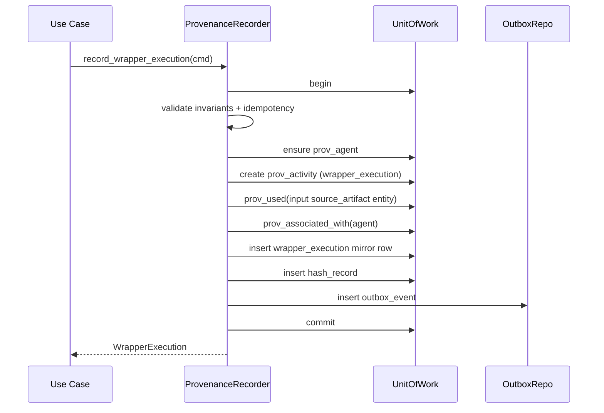

# Architecture — agrotrace-carbon-provenance-service

## 1. Mission and bounded context

This service is an **append-only provenance ledger** for the AgroTrace Carbon
platform. It records, organizes, versions and proves that the full pipeline of
data flow and emissions calculation happened exactly as claimed:

```
raw artifact
  -> wrapper execution
  -> normalized batch
  -> semantic integration
  -> canonical snapshot
  -> calculation execution
  -> calculation result set
  -> human review (optional but enforced when supplied)
  -> result publication
  -> hash record
  -> blockchain anchor
```

The bounded context **does not execute** wrappers, integrations, calculations
or anchoring; those are external systems. This service has dedicated
**outbound ports** (`OntologyClient`, `BlockchainAnchorClient`,
`WrapperMetadataClient`, `EventPublisher`) which are currently fulfilled by
no-op stubs but expose the full real contract.

## 2. Layering (Clean Architecture)

```mermaid
flowchart TD
    Client[HTTP Client] --> API[FastAPI v1 routers]
    API --> Deps[interfaces/api/deps]
    Deps --> UC[Use Cases]
    UC --> Recorder[ProvenanceRecorder]
    UC --> Repos[Repository Protocols]
    Recorder --> UoW[UnitOfWork]
    Recorder --> Hashing[domain/shared/hashing]
    UoW --> SQLA[SQLAlchemy 2.0 Session]
    Repos -.-> SQLARepos[SQLA repositories]
    SQLARepos --> SQLA
    SQLA --> SQLite[(SQLite single file\npipeline_* · prov_core_* · semantic_* · calculation_* · audit_*)]
    SQLite --> Triggers[sqlite_append_only triggers]
    Recorder --> Outbox[(audit.outbox_event)]
    OutboxWorker[OutboxWorker] --> Outbox
    OutboxWorker --> Publisher[EventPublisher port]
    Publisher -.-> NoOp[LoggingEventPublisher (stub)]
    UC -.-> Ports[OntologyClient / BlockchainAnchorClient / WrapperMetadataClient ports]
    Ports -.-> Stubs[Adapter stubs]
```

- `domain/` is **pure**. No SQLAlchemy, no FastAPI, no networking. Just
  dataclasses, enums, value objects, errors and repository **protocols**.
- `application/` orchestrates use cases through the `UnitOfWork` and ports.
  The **central writer** is `ProvenanceRecorder`; nothing else writes to
  `prov_*`.
- `infrastructure/` is the only place that imports SQLAlchemy, structlog,
  prometheus-client, apscheduler. It implements the protocols defined in the
  domain.
- `interfaces/` is thin: HTTP routers translate Pydantic DTOs into use case
  commands and convert results back into DTOs. Workers (the outbox process)
  call use case-equivalents directly.

## 3. Modelling — SQLite single schema (bounded-context prefixes)

This phase uses **one SQLite database** with table names prefixed by bounded
context (legacy PostgreSQL used separate schemas; the prefixes preserve the
same mental model):

| Prefix          | Purpose                                                         |
|-----------------|-----------------------------------------------------------------|
| `pipeline_*`    | Operational lineage (run, source artifact, wrapper, batch).     |
| `prov_core_*`   | W3C PROV graph (entities, activities, agents, relations).       |
| `semantic_*`    | Integration to the canonical ontology (snapshots, links).       |
| `calculation_*` | Method versions, parameters, executions, results, reviews.      |
| `audit_*`       | Hashes, blockchain anchors, outbox events, audit trail.         |

Highlights:

- **UUID v7** as primary keys → time-ordered IDs improve index locality and
  make manual log inspection more meaningful.
- **JSON metadata** columns (`extra_metadata` in SQLAlchemy) default to `{}`.
- **Python `StrEnum`s** are stored as strings/check constraints in SQLite.
- **Foreign keys** use `ON DELETE RESTRICT` — the ledger never cascades
  deletes; deletes don't happen on append-only tables.
- **Append-only enforcement** is layered: SQLite triggers in
  `infrastructure/db/sqlite_append_only.py` (installed after `create_all`),
  plus `ProvenanceRecorder` guards. Controlled mutability remains on
  `pipeline_pipeline_run`, `calculation_calculation_result_set` (status /
  supersede), and `audit_outbox_event` (relay). `prov_core_prov_entity` allows
  UPDATE only to set `invalidated_at`.

## 4. ProvenanceRecorder — the heart of the service

Every fact about lineage flows through `ProvenanceRecorder`. Each
`record_*` method:

1. Opens (or receives) a `UnitOfWork`.
2. Validates business invariants
   (e.g. `wrapper_execution` requires a pre-existing `source_artifact`).
3. Resolves or creates the surrounding PROV elements
   (bundle, agent, activity, entity).
4. Writes the operational mirror table (`wrapper_execution`, …).
5. Wires the PROV-DM relations
   (`used` / `generated` / `derivedFrom` / `associatedWith`).
6. Computes and persists a content hash via `compute_hash_hex` (RFC 8785).
7. Inserts an outbox event in the **same** transaction (transactional outbox).
8. Commits.



### Idempotency

When a command supplies an `idempotency_key`, the recorder looks up an
existing record before inserting. If found, the existing record is returned
unchanged. Mismatched payloads with the same key surface as
`IdempotencyConflictError` (HTTP 409).

### Hashing

Hashing is deterministic by construction — `domain/shared/hashing.py` does:

1. Normalize values (UUID/datetime/Decimal/sets → canonical strings/lists).
2. JSON-encode with sorted keys, no whitespace, `ensure_ascii=False`,
   `allow_nan=False`.
3. SHA-256 (or SHA3-256) over the resulting UTF-8 bytes.

This gives RFC 8785-equivalent canonicalization without an external dep.

## 5. Outbox

`audit.outbox_event` is written **inside the same transaction** as the
operational record. The `OutboxWorker` (APScheduler) polls pending rows in
batches, calls the `EventPublisher` port, and atomically marks them
`published` (or `failed` with a reason captured in `audit.audit_event`).

The default publisher is `LoggingEventPublisher` (no-op + structured log);
the contract is ready for Kafka/RabbitMQ/etc.

## 6. Observability

- **Structured JSON logs** via `structlog` — every record is enriched with
  `service`, `environment`, `correlation_id`.
- **Correlation IDs** propagate as `X-Correlation-ID` from request to
  response and into every log line via `contextvars`.
- **Prometheus metrics** at `/metrics`:
  - `provenance_records_total` (counter, labels `kind`, `outcome`).
  - `provenance_recorder_duration_seconds` (histogram, label `method`).
- **Liveness** at `/healthz`, **readiness** at `/readyz`
  (executes `SELECT 1` against the configured database — SQLite by default).

## 7. API surface

The full v1 surface lives under `/api/v1/`:

- **Pipeline (11)** — runs (POST/GET/list/trace/graph), source artifacts (+ revisions),
  wrapper definitions/executions, normalized batches.
- **PROV (5)** — bundles, entities, activities, agents, bundle graph (read-only).
- **Semantic (3)** — semantic integrations, canonical snapshots, ontology links.
- **Calculation (11)** — methods, method versions, parameter sets, executions,
  result sets (POST + GET), reviews, publications, aggregation links
  (POST + list children/parents).
- **Reporting (2)** — reporting periods (POST + GET) for temporal scope.
- **Audit (4)** — hash records, blockchain anchors, integrity verification,
  outbox events (with optional `status`, `aggregate_kind`, `event_type` filters).

Observable fields (`reporting_period_id`, `result_scope`, `consolidation_type`,
`hash_scope`, `canonicalization_method`, etc.) are exposed on request/response
DTOs where applicable. UPPER_SNAKE events (`CALCULATION_APPROVED`,
`MONTHLY_RESULT_CONSOLIDATED`, …) appear in the outbox stream.

Errors are emitted as **RFC 7807 Problem Details** with
`Content-Type: application/problem+json` and the request's correlation id.

## 8. Decisions and trade-offs

- **Synchronous** SQLAlchemy / FastAPI. The workload is dominated by short
  transactional writes; async would only add complexity to the UoW without
  a real performance win.
- **psycopg3** as the driver (`postgresql+psycopg://…`).
- **Append-only via triggers + REVOKE + repository guards**. Defense in
  depth gives us correctness even if a future code path forgets the rules.
- **No ORM relationships** in the domain. Domain dataclasses don't carry
  back-references; that keeps the domain framework-free and lets us swap
  the persistence layer if needed.
- **Outbox-only** event publication. Direct in-process publication is
  rejected: the only way an event leaves this service is via the outbox.
- **UUID v7** + `uuid-utils` (with `uuid4` fallback).

## 9. Future evolution

- Merkle hash chain across all hash records for cheaper batch anchoring.
- Real `OntologyClient`, `BlockchainAnchorClient`, `WrapperMetadataClient`
  HTTP adapters.
- RBAC + per-tenant row-level security.
- PROV-O export (RDF/Turtle) at `/api/v1/bundles/{id}/prov-o`.
- Replay verifier for chained pipeline runs (`parent_pipeline_run_id`).
