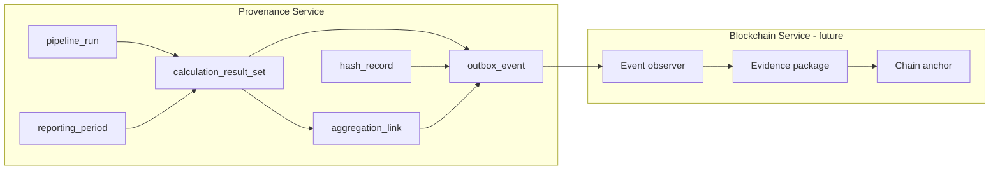

# Blockchain observability preparation

This document describes incremental changes in the **AgroTrace Carbon Provenance Service**
(`provenance_service`) to make the ledger more auditable and observable for a future
**blockchain-service** integration. No real blockchain, Merkle roots, or evidence packages
are implemented in this phase.

## 1. Role of provenance vs blockchain-service

| Responsibility | Provenance service | Blockchain service (future) |
|---|---|---|
| Record lineage | Yes — append-only ledger | No |
| Emit observable events | Yes — via `audit_outbox_event` | Consumes outbox |
| Hash individual records | Yes — `audit_hash_record` | May anchor hashes |
| Build evidence packages | No | Yes |
| Submit to chain | Mirror only — `audit_blockchain_anchor` | Yes |

The provenance service remains the **source of truth for what happened**. The blockchain
service will observe outbox events and decide when to anchor or package evidence.

## 2. Observable events

Observable events use **UPPER_SNAKE** `event_type` values in the same outbox stream as
existing dotted events (e.g. `calculation_result_set.recorded`). Both coexist for backward
compatibility.

| Event | When emitted |
|---|---|
| `CALCULATION_PRELIMINARY_RESULT_CREATED` | Result set status is `preliminary` |
| `MONTHLY_RESULT_CONSOLIDATED` | `result_scope=monthly` with consolidation type |
| `ANNUAL_RESULT_CONSOLIDATED` | `result_scope=annual` with consolidation type |
| `CALCULATION_APPROVED` | Review decision is `approved` |
| `CALCULATION_REJECTED` | Review decision is `rejected` |
| `APPROVED_RESULT_PUBLISHED_TO_ONTOLOGY` | Publication status is `published` |
| `LOCAL_HASH_CREATED` | Any hash recorded via recorder |
| `DAILY_DATA_AGGREGATED_TO_MONTHLY` | Aggregation link `daily_to_monthly` |
| `MONTHLY_DATA_AGGREGATED_TO_ANNUAL` | Aggregation link `monthly_to_annual` |

Events start with `status=pending`. New outbox statuses `processing` and `processed`
support future relay/worker evolution.

Use `ProvenanceRecorder.record_observable_event(...)` or the domain-specific recorder
methods that call it internally. All events are written in the **same transaction** as the
business record.

## 3. Outbox evolution (`audit_outbox_event`)

The existing outbox table was extended (not renamed) with nullable reference columns:

- `pipeline_run_id`, `calculation_execution_id`, `calculation_result_set_id`
- `reporting_period_id`, `source_table`, `source_record_id`
- `error_message`, `retry_count`, `locked_at`, `locked_by`, `processed_at`

This allows the future blockchain observer to correlate events without parsing payload JSON.

## 4. Reporting period (`reporting_period`)

New bounded context for temporal scope:

- Granularity: `daily`, `monthly`, `annual`, `custom`
- Status lifecycle: `open` → `closed` → `consolidated` → `approved` → `published` → `superseded`
- **Mutable** (unlike most ledger tables) — periods can transition status
- Linked from `pipeline_run`, `calculation_execution`, `calculation_result_set`, etc.

Recorder API: `record_reporting_period(RecordReportingPeriodCommand)`.

## 5. Aggregation links (`calculation_result_aggregation_link`)

Links parent/child result sets across reporting periods:

- `aggregation_type`: `daily_to_monthly`, `monthly_to_annual`, `manual_grouping`
- Optional `parent_period_id` / `child_period_id` FKs to `reporting_period`
- **Append-only** — links are never updated or deleted

Recorder API: `record_result_aggregation_link(RecordResultAggregationLinkCommand)`.

## 6. Hash records (`audit_hash_record`)

Extended for canonicalization metadata:

| Field | Purpose |
|---|---|
| `hash_scope` | Semantic scope (record, snapshot, calculation_result, …) |
| `canonicalization_method` | Default `json_canonical_v1` |
| `canonical_payload_hash` | Hash of canonical JSON payload |
| `canonical_payload_ref` | Optional external storage URI |
| `created_by_service` | Service version that computed the hash |
| `created_at` | When the hash record was created |

Existing rows remain valid — all new fields are nullable.

## 7. Why Merkle roots and evidence packages stay out

Merkle trees and evidence packages are **aggregation concerns** for the blockchain-service.
The provenance service records atomic facts (hashes, events, lineage). Bundling many hashes
into a Merkle root or packaging evidence for chain submission belongs in the observer/anchor
layer, not in the append-only ledger.

## 8. Future events (not yet implemented)

The following may be added when the blockchain-service defines its contract:

- `RAW_DATA_REGISTERED`, `WRAPPER_EXECUTED`, `CANONICAL_SNAPSHOT_PUBLISHED`
- Chain-specific anchor confirmation events
- Dead-letter / retry exhaustion notifications

## 9. Delivered improvements summary



- New enums: `PeriodGranularity`, `ReportingPeriodStatus`, `ResultScope`, `ConsolidationType`,
  `AggregationType`, `HashScope`, `RunType`, `AnchorMode`
- Extended `OutboxStatus`: `processing`, `processed`
- Nullable columns on pipeline, semantic, calculation, audit tables
- Append-only protection for `calculation_parameter_value` and `result_aggregation_link`
- PostgreSQL parity migration: `alembic/versions/0010_blockchain_observability.py`

## 10. HTTP surface (REST)

| Method | Path | Purpose |
|--------|------|---------|
| POST | `/api/v1/reporting-periods` | Create reporting period |
| GET | `/api/v1/reporting-periods/{id}` | Fetch reporting period |
| POST | `/api/v1/result-aggregation-links` | Link parent/child result sets |
| GET | `/api/v1/calculation-result-sets/{id}/aggregation-children` | List child links |
| GET | `/api/v1/calculation-result-sets/{id}/aggregation-parents` | List parent links |
| GET | `/api/v1/audit/outbox-events?event_type=...` | Filter observable events |

Request/response DTOs for pipeline, semantic, calculation, and audit contexts
also expose optional observability fields (`reporting_period_id`, `result_scope`,
`hash_scope`, `canonicalization_method`, etc.).

## 11. Running tests

```bash
pytest tests/integration/observability -v
pytest tests/invariants/test_append_only.py -v
pytest -q
```

All tests use SQLite; no Docker or PostgreSQL required for the default test path.
