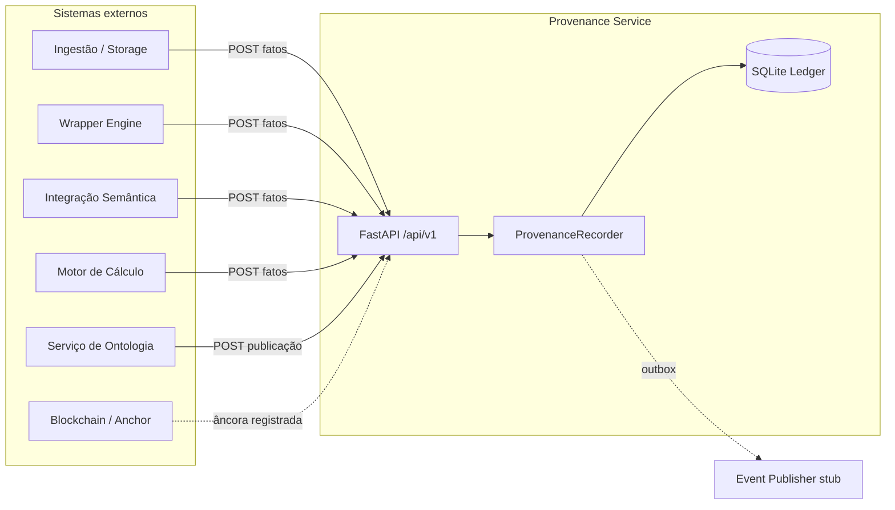
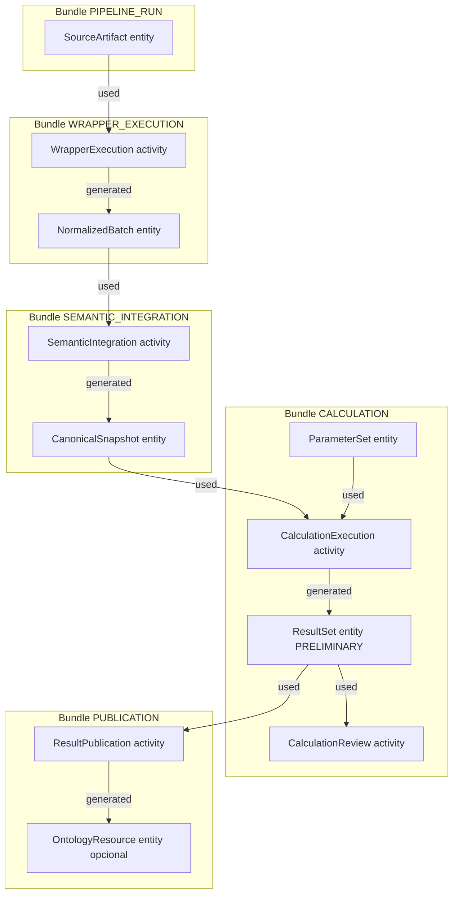
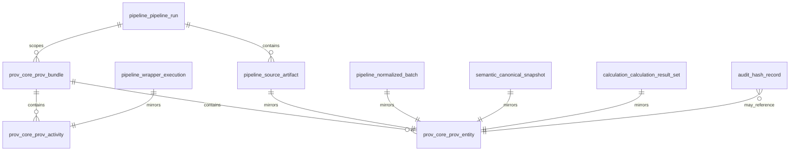

# Documentação Oficial de Arquitetura e Dados — agrotrace-carbon-provenance-service

**Versão do documento:** 1.0 (baseada na implementação atual do repositório)  
**Público-alvo:** desenvolvedores, arquitetos, auditores, pesquisadores e equipes de onboarding  
**Escopo:** arquitetura de software, modelo relacional SQLite-first, proveniência formal (W3C PROV-DM) e fluxo completo da pipeline de carbono

---

## Sumário

1. [Introdução](#1-introdução)
2. [Papel do serviço de proveniência na arquitetura](#2-papel-do-serviço-de-proveniência-na-arquitetura)
3. [Visão geral da arquitetura](#3-visão-geral-da-arquitetura)
4. [Fluxo completo da pipeline](#4-fluxo-completo-da-pipeline)
5. [Explicação detalhada de cada tabela](#5-explicação-detalhada-de-cada-tabela)
6. [Relações entre as tabelas](#6-relações-entre-as-tabelas)
7. [Como a proveniência é registrada formalmente](#7-como-a-proveniência-é-registrada-formalmente)
8. [Exemplos práticos](#8-exemplos-práticos)
9. [Exemplo narrativo ponta a ponta](#9-exemplo-narrativo-ponta-a-ponta)
10. [Estratégias de integridade, append-only e versionamento](#10-estratégias-de-integridade-append-only-e-versionamento)
11. [Consultas e rastreabilidade](#11-consultas-e-rastreabilidade)
12. [Limitações atuais e evolução futura](#12-limitações-atuais-e-evolução-futura)
13. [Conclusão](#13-conclusão)

---

## 1. Introdução

### 1.1 O que é o serviço

O **agrotrace-carbon-provenance-service** (pacote Python `provenance_service`) é um **ledger de proveniência append-only** para a plataforma AgroTrace Carbon. Ele não executa transformações de negócio (wrapper, integração semântica, motor de cálculo ou publicação em ontologia); ele **registra, organiza, versiona e prova** que a cadeia de processamento aconteceu conforme declarado pelos sistemas produtores.

Em termos de domínio, o serviço materializa uma **trilha de evidências** ligada a uma execução de pipeline (`pipeline_run`), espelhando fatos operacionais em tabelas de contexto (`pipeline_*`, `semantic_*`, `calculation_*`, `audit_*`) e, em paralelo, um **grafo formal de proveniência** inspirado no W3C PROV-DM (`prov_core_*`).

### 1.2 Qual problema ele resolve

Em pipelines de emissões de carbono e rastreabilidade agrícola, múltiplos sistemas produzem artefatos intermediários e finais. Sem um registro centralizado e imutável:

- não é possível responder com rigor *“de onde veio este resultado?”*;
- auditorias externas dependem de logs dispersos e não estruturados;
- reprocessamentos e correções de dados tornam-se indistinguíveis de fraudes ou erros não documentados;
- a aprovação humana de resultados preliminares perde valor probatório.

O serviço resolve isso ao ser o **ponto único de escrita** da proveniência, com hashes determinísticos, relações formais entre entradas e saídas, e eventos de auditoria transacionais.

### 1.3 Por que proveniência é importante neste projeto

A plataforma AgroTrace Carbon trata dados que impactam **decisões regulatórias, comerciais e ambientais**. A proveniência responde a perguntas como:

- qual arquivo bruto originou o cálculo publicado?
- qual versão do wrapper e do método de cálculo foi aplicada?
- quem aprovou o resultado antes da publicação na ontologia?
- o snapshot canônico usado no cálculo corresponde a qual integração semântica?

Sem proveniência estruturada, o sistema produz números, mas não produz **confiança verificável**.

### 1.4 Trilha de evidências, auditoria e confiabilidade

O projeto combina três mecanismos complementares:

| Mecanismo | Onde vive | Função |
|-----------|-----------|--------|
| **Grafo PROV** | `prov_core_*` | Modelo formal de entidades, atividades, agentes e relações (`used`, `generated`, `derivedFrom`, …) |
| **Espelho operacional** | `pipeline_*`, `semantic_*`, `calculation_*` | Consulta eficiente por run, artefato, execução, resultado |
| **Auditoria criptográfica** | `audit_hash_record`, `audit_blockchain_anchor` | Integridade de conteúdo e preparação para ancoragem externa |
| **Eventos** | `audit_outbox_event`, `audit_audit_event` | Integração assíncrona e trilha de decisões (ex.: review aprovada) |

### 1.5 Por que SQLite nesta fase (SQLite-first)

A fase atual adota **SQLite como banco único** com:

- **33 tabelas** em um schema, prefixadas por bounded context (`pipeline_*`, `prov_core_*`, …);
- bootstrap via `Base.metadata.create_all` + triggers em `sqlite_append_only.py` (não via Alembic no fluxo local);
- `PRAGMA foreign_keys=ON` e `journal_mode=WAL` para integridade referencial e concorrência de leitura.

**Motivações:** simplicidade operacional para desenvolvimento, testes e demos; ledger autocontido em arquivo; enforcement de append-only via triggers SQLite; alinhamento com dissertação/prototipação antes de escalar para PostgreSQL multi-schema (migrações Alembic `0001`–`0009` existem como trajetória legada).

> **Nota de divergência:** o `ARCHITECTURE.md` ainda menciona readiness com `SELECT 1` contra Postgres em alguns trechos; em runtime SQLite-first, o readiness valida o arquivo SQLite configurado.

---

## 2. Papel do serviço de proveniência na arquitetura

### 2.1 Posicionamento no ecossistema



O serviço situa-se como **camada transversal de evidência**: todos os estágios reportam fatos; nenhum estágio altera o ledger diretamente fora do `ProvenanceRecorder`.

### 2.2 O que o serviço faz

- Inicia e acompanha **execuções de pipeline** (`pipeline_run`).
- Registra **artefatos**, **execuções**, **snapshots**, **cálculos**, **reviews** e **publicações**.
- Materializa o **grafo PROV** correspondente a cada fato.
- Calcula e persiste **hashes** de conteúdo (RFC 8785 + SHA-256).
- Enfileira **eventos de outbox** na mesma transação dos fatos.
- Expõe APIs de **leitura** (trace, grafo de bundle, verificação de integridade).
- Prepara contratos para **ontologia**, **blockchain** e **metadados de wrapper** (ports com stubs).

### 2.3 O que o serviço NÃO faz

| Responsabilidade | Onde deve ocorrer |
|------------------|-------------------|
| Executar wrapper / normalizar CSV | Wrapper Engine externo |
| Mapear para modelo canônico / RDF | Integração semântica externa |
| Calcular emissões | Motor de cálculo externo |
| Publicar triplas na ontologia de produção | OntologyClient (port) |
| Submeter transação on-chain | BlockchainAnchorClient (port) |
| Agregar séries temporais de negócio | Fora do ledger (README/demo explicitam ausência de tabelas de agregação) |

### 2.4 Relação com wrappers, cálculo, ontologia e blockchain

| Integração | Porta de aplicação | Estado atual | Papel no ledger |
|------------|-------------------|--------------|-----------------|
| Wrapper | `WrapperMetadataClient` | Stub | Metadados de definição podem ser enriquecidos; execução registrada via API |
| Ontologia | `OntologyClient` | Stub | `ontology_resource_link` + entidade `ONTOLOGY_RESOURCE` na publicação |
| Blockchain | `BlockchainAnchorClient` | Stub | `audit_blockchain_anchor` referencia `audit_hash_record` |
| Eventos | `EventPublisher` | `LoggingEventPublisher` | Consome `audit_outbox_event` via `OutboxWorker` |

### 2.5 Ledger append-only de proveniência

O serviço deve ser entendido como um **livro-razão de fatos históricos**:

- fatos críticos não são apagados nem reescritos (triggers SQLite);
- correções produzem **novas entidades/revisões**, não mutação destrutiva do passado;
- status operacionais (`pipeline_run.run_status`, `calculation_result_set.result_set_status`) são exceções controladas em tabelas **mutáveis**;
- o `ProvenanceRecorder` é o **único escritor** autorizado do grafo `prov_core_*`.

---

## 3. Visão geral da arquitetura

### 3.1 Clean Architecture / DDD leve

```
src/provenance_service/
├── domain/           # Entidades, enums, protocolos de repositório (puro)
├── application/      # Use cases, UnitOfWork, ProvenanceRecorder, ports
├── infrastructure/   # SQLAlchemy, adapters, outbox, observability
└── interfaces/       # FastAPI (HTTP), workers
```

**Regra de dependência:** `domain` não importa SQLAlchemy nem FastAPI. `application` depende apenas de `domain` e de protocolos. `infrastructure` implementa os protocolos. `interfaces` traduz HTTP → comandos → use cases.

### 3.2 Camadas em detalhe

#### Domain (`domain/`)

Bounded contexts:

- `pipeline/` — run, artefato, wrapper, batch
- `prov_core/` — bundle, entity, activity, agent, relações
- `semantic/` — integração, snapshot, link ontológico
- `calculation/` — método, execução, resultado, review, publicação
- `audit/` — hash, âncora, outbox, audit_event
- `shared/` — enums, hashing, IDs (UUID v7), erros

#### Application (`application/`)

- **22 use cases** (17 de escrita, 5 de leitura/verificação)
- **`ProvenanceRecorder`** — escritor central (~2340 linhas)
- **`UnitOfWork`** — fronteira transacional agregando todos os repositórios
- **Ports** — contratos para integrações externas

#### Infrastructure (`infrastructure/`)

- Modelos ORM: `infrastructure/db/models/*.py`
- Repositórios: `infrastructure/db/repositories/*.py`
- `SqlAlchemyUnitOfWork`, `session.py`, `sqlite_append_only.py`
- Outbox worker, métricas Prometheus, structlog

#### Interfaces (`interfaces/`)

- API REST `/api/v1/` (pipeline, prov, semantic, calculation, audit)
- `deps.py` — injeção: settings → session → UoW → recorder → use case
- Health (`/healthz`), readiness (`/readyz`), métricas (`/metrics`)

### 3.3 ProvenanceRecorder — coração do serviço

Todo fato de linhagem passa por métodos `start_pipeline_run` / `record_*`. Cada operação típica:

1. Valida invariantes e idempotência (`idempotency_key`)
2. Resolve/cria `prov_bundle` por fase (`ProvBundleType`)
3. Cria `prov_entity` / `prov_activity` / `prov_agent`
4. Persiste linha espelho (`pipeline_*`, etc.)
5. Liga relações PROV (`used`, `generated`, `derivedFrom`, `associatedWith`)
6. Grava `audit_hash_record` quando aplicável
7. Insere `audit_outbox_event` na **mesma transação**
8. Use case executa `uow.commit()`

**APIs e adaptadores nunca escrevem em `prov_core_*` diretamente.**

### 3.4 Unit of Work e repositórios

O protocolo `UnitOfWork` expõe um repositório por agregado/tabela principal. Implementação `SqlAlchemyUnitOfWork` mapeia entidades de domínio ↔ modelos ORM via `_mappers.py`.

Linhas filhas sem repositório dedicado:

- `calculation_parameter_value` — via `CalculationParameterSetRepository.add_value`
- `canonical_snapshot_item` — via `CanonicalSnapshotRepository.add_item`
- Relações PROV — via `ProvRelationRepository`

### 3.5 API e testes

| Router | Prefixo | Escrita via recorder |
|--------|---------|----------------------|
| pipeline | `/api/v1/` | runs, artifacts, wrapper, batches |
| semantic | `/api/v1/` | integrations, snapshots, ontology links |
| calculation | `/api/v1/` | methods, executions, results, reviews, publications |
| audit | `/api/v1/` | hashes, anchors, verify |
| prov | `/api/v1/` | **somente leitura** |

Testes relevantes: `tests/integration/recorder/test_recorder_full_flow.py`, `tests/invariants/test_append_only.py`, `scripts/demo_repository_full_population/demo_runner.py`.

---

## 4. Fluxo completo da pipeline

Pipeline de negócio (intenção do produto):

```
dado bruto → wrapper versionado → dado normalizado → integração semântica
→ snapshot canônico → execução do cálculo → resultado preliminar
→ aprovação humana → publicação na ontologia → hash → âncora blockchain (opcional)
```

### 4.1 Dado bruto

| Aspecto | Detalhe |
|---------|---------|
| **O que acontece** | Sistema de ingestão declara recebimento de arquivo bruto vinculado a um `pipeline_run` |
| **Por quê** | Estabelecer origem verificável de toda a cadeia |
| **Tabelas** | `pipeline_source_artifact`, `prov_core_prov_entity`, `audit_hash_record` |
| **PROV** | `ProvEntity` tipo `SOURCE_ARTIFACT` no bundle `PIPELINE_RUN`; hash `HashSubjectKind.SOURCE_ARTIFACT` |
| **Agentes** | Opcional: quem disparou o run (`pipeline_run.triggered_by_agent_id`) |
| **Rastreabilidade** | `content_hash` + `storage_uri` + FK `prov_entity_id` |

**Endpoint:** `POST /api/v1/source-artifacts` → `RegisterSourceArtifact` → `record_source_artifact`

### 4.2 Wrapper versionado

**Catálogo (global):** `POST /api/v1/wrapper-definitions` → `pipeline_wrapper_definition` (sem PROV).

**Execução:**

| Aspecto | Detalhe |
|---------|---------|
| **O que acontece** | Wrapper externo processa artifact e reporta execução |
| **Tabelas** | `pipeline_wrapper_execution`, `prov_core_prov_activity` |
| **PROV** | Activity `WRAPPER_EXECUTION`; bundle `WRAPPER_EXECUTION` |
| **Relações** | `prov_used` ← artifact (ou revisão); `prov_associated_with` ← agente `SOFTWARE` |
| **Invariante** | `input_artifact_id` deve pertencer ao mesmo `pipeline_run_id` |

### 4.3 Dado normalizado

| Aspecto | Detalhe |
|---------|---------|
| **O que acontece** | Saída tabular/normalizada do wrapper é registrada como batch |
| **Tabelas** | `pipeline_normalized_batch`, `prov_core_prov_entity` |
| **PROV** | Entity `NORMALIZED_BATCH`; `prov_generated` pela activity do wrapper; `prov_derived_from` (`wrapper_normalization`) do artifact |
| **Hash** | Se `content_hash` informado → `NORMALIZED_BATCH` |

### 4.4 Integração semântica

| Aspecto | Detalhe |
|---------|---------|
| **O que acontece** | Serviço semântico mapeia batch para vocabulário canônico |
| **Tabelas** | `semantic_semantic_integration_execution` |
| **PROV** | Activity `SEMANTIC_INTEGRATION`; bundle `SEMANTIC_INTEGRATION` |
| **Relações** | `prov_used` ← entidade do batch; `prov_associated_with` ← integrator software |

### 4.5 Snapshot canônico

| Aspecto | Detalhe |
|---------|---------|
| **O que acontece** | Persistência do grafo/dados canônicos prontos para cálculo |
| **Tabelas** | `semantic_canonical_snapshot`, `semantic_canonical_snapshot_item` (opcional) |
| **PROV** | Entity `CANONICAL_SNAPSHOT`; `prov_generated` pela integração; `prov_derived_from` do batch |
| **Hash** | `snapshot_hash` determinístico (payload canônico RFC 8785) |
| **Idempotência** | Reuso se `snapshot_hash` já existir |

### 4.6 Execução do cálculo

**Pré-requisitos de catálogo:** `calculation_method`, `calculation_method_version`, `calculation_parameter_set` (+ values).

| Aspecto | Detalhe |
|---------|---------|
| **O que acontece** | Motor de cálculo consome snapshot + parâmetros e executa método versionado |
| **Tabelas** | `calculation_calculation_execution` |
| **PROV** | Activity `CALCULATION_EXECUTION`; bundle `CALCULATION` |
| **Relações** | `prov_used` ← snapshot + parameter set; `prov_associated_with` ← executor |

### 4.7 Resultado preliminar

| Aspecto | Detalhe |
|---------|---------|
| **O que acontece** | Resultado nasce com status **`preliminary`** — não é resultado final auditável para publicação |
| **Tabelas** | `calculation_calculation_result_set`, `calculation_calculation_result_item` |
| **PROV** | Entity `CALCULATION_RESULT_SET`; `prov_generated` pela activity de cálculo |
| **Hash** | `summary_hash` sobre itens ordenados |

> **Decisão de produto:** o cálculo não nasce final; nasce **preliminar** até revisão humana.

### 4.8 Aprovação humana

| Aspecto | Detalhe |
|---------|---------|
| **O que acontece** | Revisor humano registra decisão sobre o result set |
| **Tabelas** | `calculation_calculation_review`, `audit_audit_event` |
| **PROV** | Activity `CALCULATION_REVIEW`; `prov_used` ← result set; `prov_associated_with` ← agente `HUMAN` |
| **Efeito** | Se `APPROVED` e status era `preliminary` → `result_set_status` atualizado para `approved` (tabela mutável) |

### 4.9 Publicação final

| Aspecto | Detalhe |
|---------|---------|
| **O que acontece** | Resultado aprovado é publicado na ontologia (estágio final) |
| **Tabelas** | `calculation_result_publication_execution`, opcional `semantic_ontology_resource_link` |
| **PROV** | Activity `RESULT_PUBLICATION`; bundle `PUBLICATION` |
| **Invariantes** | Result set `approved`; review `approved` (explícito ou último aprovado) |
| **Relações** | `prov_used` result set; opcional `prov_generated` → `ONTOLOGY_RESOURCE` |

### 4.10 Integridade por hash

| Aspecto | Detalhe |
|---------|---------|
| **Automático** | Recorder chama `_record_hash_internal` em artifact, revisão, batch, snapshot, parameter set, result set |
| **Explícito** | `POST /api/v1/hash-records` → `ComputeAndRecordHash` |
| **Verificação** | `GET /api/v1/audit/verify/{bundle_id}` recomputa e compara |
| **Blockchain** | `POST /api/v1/blockchain-anchors` referencia `hash_record_id` (sem activity `BLOCKCHAIN_ANCHORING` no recorder hoje) |

### Diagrama do fluxo com bundles PROV



---

## 5. Explicação detalhada de cada tabela

O projeto possui **33 tabelas** agrupadas em 5 contextos lógicos. Nomes físicos SQLite: `{contexto}_{entidade}`.

### Legenda das subseções por tabela

Para cada tabela: **papel conceitual**, **papel operacional**, **momento de uso**, **relação com pipeline/PROV**, **campos principais**, **exemplo**, **importância para auditoria**.

---

### 5.1 Contexto `pipeline` (6 tabelas)

#### 5.1.1 `pipeline_pipeline_run`

| Dimensão | Descrição |
|----------|-----------|
| **Conceitual** | Unidade de trabalho que amarra todos os fatos de uma execução (fazenda + período + ciclo de vida) |
| **Operacional** | Container transacional e índice de consulta por `farm_reference` / `reporting_period_reference` |
| **Momento** | Primeiro registro da pipeline (`POST /api/v1/pipeline-runs`) |
| **Pipeline** | Eixo central; quase todas as FKs apontam para `pipeline_run_id` |
| **PROV** | Não cria entidade PROV diretamente; bundles referenciam o run |
| **Mutabilidade** | **Mutável** — status e `finished_at` podem evoluir |

**Campos principais:**

| Coluna | Tipo / constraint | Significado |
|--------|-------------------|-------------|
| `pipeline_run_id` | PK UUID | Identificador time-ordered (UUID v7) |
| `run_code` | UK string | Código humano único (ex.: `RUN-FAZENDA-2024-Q1-001`) |
| `farm_reference` | string | Referência da propriedade/fazenda |
| `reporting_period_reference` | string | Período de reporte (ex.: `2024-Q1`) |
| `run_status` | enum string | `pending`, `running`, `succeeded`, `failed`, `cancelled`, `superseded` |
| `started_at` / `finished_at` | timestamptz | Janela temporal; CK `finished_at >= started_at` |
| `parent_pipeline_run_id` | FK self | Reprocessamento encadeado |
| `triggered_by_agent_id` | FK → `prov_agent` | Quem/sistema disparou o run |
| `idempotency_key` | UK opcional | Retries seguros |
| `metadata` | JSON | Extensões sem quebrar schema |

**Exemplo:**

```json
{
  "pipeline_run_id": "0192a3f0-7c4b-7000-8000-000000000001",
  "run_code": "RUN-FAZ-SANTA-ROSA-2024-Q1",
  "farm_reference": "FAZ-SANTA-ROSA",
  "reporting_period_reference": "2024-Q1",
  "run_status": "running",
  "started_at": "2024-03-15T08:00:00Z"
}
```

---

#### 5.1.2 `pipeline_source_artifact`

| Dimensão | Descrição |
|----------|-----------|
| **Conceitual** | Representação do **dado bruto** recebido (arquivo, URI, hash) |
| **Operacional** | Ponte entre storage externo e grafo PROV |
| **Momento** | Após início do run, antes do wrapper |
| **PROV** | 1:1 com `prov_entity` (`SOURCE_ARTIFACT`); UK em `prov_entity_id` |
| **Append-only** | Sim |

**Campos principais:** `source_system`, `original_filename`, `storage_uri`, `content_hash`, `received_at`, `mime_type`, `file_size_bytes`, `idempotency_key`, `metadata`.

**Exemplo:** `original_filename`: `inventario_2024_q1.csv`, `content_hash`: `sha256:abc123...`, `storage_uri`: `s3://bucket/raw/inventario_2024_q1.csv`.

---

#### 5.1.3 `pipeline_source_artifact_revision`

| Dimensão | Descrição |
|----------|-----------|
| **Conceitual** | Versão substitutiva ou corrigida do mesmo artefato lógico |
| **Operacional** | Suporta reenvio/correção sem apagar revisão anterior |
| **Momento** | Quando arquivo bruto é substituído ou republicado |
| **PROV** | Nova `prov_entity` `SOURCE_ARTIFACT_REVISION` + `prov_revision` (previous → new) |
| **Modelagem** | UK (`source_artifact_id`, `revision_number`); índice único parcial `is_current=1` por artefato |

**Campos principais:** `revision_number` (≥1), `storage_uri`, `content_hash`, `is_current`, `prov_entity_id` (opcional na revisão).

---

#### 5.1.4 `pipeline_wrapper_definition`

| Dimensão | Descrição |
|----------|-----------|
| **Conceitual** | Catálogo versionado de wrappers (nome + versão + layout de origem) |
| **Operacional** | Referência estável para auditoria de qual código/layout transformou o dado |
| **Momento** | Cadastro prévio à execução (pode ser global, fora de um run específico) |
| **PROV** | **Não** gera PROV (catálogo técnico) |
| **Mutabilidade** | Mutável (`is_active`, metadados) |

**Campos principais:** `wrapper_name`, `wrapper_version`, `source_layout_name`, `source_layout_version`, `code_hash`, `schema_version`.

---

#### 5.1.5 `pipeline_wrapper_execution`

| Dimensão | Descrição |
|----------|-----------|
| **Conceitual** | Execução concreta de um wrapper sobre um artifact |
| **Operacional** | Registro de status, tempos, contagens de warning/erro |
| **Momento** | Após artifact (e definição de wrapper) existirem |
| **PROV** | 1:1 com `prov_activity` `WRAPPER_EXECUTION` |

**FKs:** `wrapper_definition_id`, `input_artifact_id`, `input_source_artifact_revision_id` (opcional), `prov_activity_id`.

---

#### 5.1.6 `pipeline_normalized_batch`

| Dimensão | Descrição |
|----------|-----------|
| **Conceitual** | Saída normalizada (batch) pronta para integração semântica |
| **Operacional** | `batch_code`, `schema_version`, `record_count`, `storage_uri` |
| **Momento** | Após wrapper bem-sucedido |
| **PROV** | Entity `NORMALIZED_BATCH`; derivada do artifact via `derivedFrom` |

**Campos principais:** `content_hash`, `generated_at`, `wrapper_execution_id` (FK obrigatória).

---

### 5.2 Contexto `prov_core` (10 tabelas)

#### 5.2.1 `prov_core_prov_bundle`

| Dimensão | Descrição |
|----------|-----------|
| **Conceitual** | Agrupador de proveniência por **fase** da pipeline dentro de um run |
| **Operacional** | Facilita exportação, verificação e visualização de grafo por estágio |
| **Momento** | Criado sob demanda por `_ensure_bundle` no recorder |
| **Tipos** | `pipeline_run`, `wrapper_execution`, `semantic_integration`, `calculation`, `publication`, `audit` (último não usado pelo recorder hoje) |
| **Append-only** | Sim (fechamento de bundle via `close()` bloqueado por trigger) |

**Campos:** `bundle_type`, `status` (`open`/`closed`/`invalidated`), `created_at`, `closed_at`, `metadata`.

---

#### 5.2.2 `prov_core_prov_entity`

| Dimensão | Descrição |
|----------|-----------|
| **Conceitual** | “Coisa” com existência no tempo — artifact, batch, snapshot, result set, etc. |
| **Operacional** | Espelho formal com `entity_kind` + `entity_ref_id` apontando para linha operacional |
| **PROV** | Núcleo do modelo; tipos em `ProvEntityType` |
| **Exceção append-only** | UPDATE permitido **somente** para `invalidated_at` (soft invalidation) |

**Campos principais:** `entity_type`, `entity_kind`, `entity_ref_id`, `business_key`, `content_hash`, `invalidated_at`.

---

#### 5.2.3 `prov_core_prov_activity`

| Dimensão | Descrição |
|----------|-----------|
| **Conceitual** | Processo que consome e/ou gera entidades |
| **Operacional** | 1:1 com execuções (wrapper, integração, cálculo, review, publicação) |
| **Tipos** | `wrapper_execution`, `semantic_integration`, `calculation_execution`, `calculation_review`, `result_publication`, … |

**Campos:** `activity_type`, `status`, `started_at`, `ended_at`, `software_version`, `business_key`.

---

#### 5.2.4 `prov_core_prov_agent`

| Dimensão | Descrição |
|----------|-----------|
| **Conceitual** | Responsável: humano, software ou organização |
| **Operacional** | UK (`agent_type`, `external_reference`) para deduplicação |
| **Momento** | Software agent auto-criado pelo recorder; humano pré-cadastrado para reviews |

**Tipos:** `human`, `software`, `organization`.

---

#### 5.2.5 `prov_core_prov_used`

| Dimensão | Descrição |
|----------|-----------|
| **Conceitual** | Relação PROV-DM **Used**: uma activity consumiu uma entity como entrada |
| **Operacional** | Aresta dirigida `activity` → `entity` com papel opcional |
| **Momento** | Cada vez que o recorder registra consumo explícito de insumo |
| **Pipeline** | Materializa dependências entre estágios no grafo |
| **PROV** | Tabela relacional pura — sem espelho operacional próprio |
| **Append-only** | Sim |

**Campos:** `used_id` (PK), `activity_id` (FK), `entity_id` (FK), `role`, `used_at`, `metadata`.

**UK:** (`activity_id`, `entity_id`, `role`) — evita duplicata da mesma entrada.

**Exemplos concretos:**

| Activity | Entity usada | role |
|----------|--------------|------|
| WrapperExecution | SourceArtifact | `input` (implícito) |
| CalculationExecution | CanonicalSnapshot | `canonical_input` |
| CalculationExecution | ParameterSet | `parameters` |
| CalculationReview | ResultSet | `subject` |

---

#### 5.2.6 `prov_core_prov_generated`

| Dimensão | Descrição |
|----------|-----------|
| **Conceitual** | Relação **WasGeneratedBy**: entity produzida por activity |
| **Operacional** | UK (`entity_id`, `activity_id`) — cada entity tem no máximo um gerador direto por activity |
| **Momento** | Registro de batch, snapshot, result set, ontology resource |
| **Pipeline** | Complementa FKs operacionais (ex.: `wrapper_execution_id` no batch) com semântica PROV |
| **Append-only** | Sim |

**Exemplos:** NormalizedBatch ← WrapperExecution; CanonicalSnapshot ← SemanticIntegration; CalculationResultSet ← CalculationExecution.

---

#### 5.2.7 `prov_core_prov_derived_from`

| Dimensão | Descrição |
|----------|-----------|
| **Conceitual** | Relação **WasDerivedFrom**: entity derivada de outra sem necessariamente repetir a activity |
| **Operacional** | UK (`generated_entity_id`, `source_entity_id`, `derivation_type`) |
| **Momento** | Normalização (batch ← artifact), snapshot ← batch |
| **Pipeline** | Expressa linhagem de conteúdo quando `generated` sozinho não basta |
| **Append-only** | Sim |

**`derivation_type` usados pelo recorder:** `wrapper_normalization` (batch), derivação semântica snapshot ← batch.

---

#### 5.2.8 `prov_core_prov_associated_with`

| Dimensão | Descrição |
|----------|-----------|
| **Conceitual** | Relação **WasAssociatedWith**: agente responsável por uma activity |
| **Operacional** | UK (`activity_id`, `agent_id`, `role`) |
| **Momento** | Toda activity registrada pelo recorder associa ao menos o agente software |
| **Pipeline** | Crítico para governança — especialmente reviews humanas |
| **Append-only** | Sim |

**Papéis típicos:** executor (wrapper/cálculo), integrator (semântica), reviewer (humano), publisher (publicação).

---

#### 5.2.9 `prov_core_prov_revision`

| Dimensão | Descrição |
|----------|-----------|
| **Conceitual** | Encadeamento **previous → new** entre entidades PROV (versionamento) |
| **Operacional** | UK (`previous_entity_id`, `new_entity_id`) |
| **Momento** | `record_source_artifact_revision`, `record_revision` genérico |
| **Pipeline** | Preserva histórico quando arquivo bruto é corrigido |
| **Append-only** | Sim |

**Campos:** `revision_reason`, `revised_at`, `metadata`.

**Exemplo:** entity do CSV original → entity da revisão 2 após correção de encoding.

---

#### 5.2.10 `prov_core_prov_attribute`

| Dimensão | Descrição |
|----------|-----------|
| **Conceitual** | Atributos extensíveis (par chave/valor JSON) anexados a entity, activity ou agent |
| **Operacional** | Flexibilidade sem alterar schema relacional |
| **Momento** | **Não** usado pelo `ProvenanceRecorder` em produção; demos podem inserir via UoW |
| **Pipeline** | Enriquecimento opcional (ex.: tags de qualidade, scores) |
| **Observação** | Sem CHECK exigindo `entity_id` OR `activity_id` OR `agent_id` |
| **Append-only** | Sim |

**Campos:** `prov_attribute_id`, `attr_key`, `attr_value` (JSON), `recorded_at`, FKs opcionais.

**Exemplo:** `attr_key=data_quality_score`, `attr_value={"score": 0.97}`, `entity_id=<artifact entity>`.

---

### 5.3 Contexto `semantic` (4 tabelas)

#### 5.3.1 `semantic_semantic_integration_execution`

| Dimensão | Descrição |
|----------|-----------|
| **Conceitual** | Registro da **integração semântica**: mapeamento do batch normalizado para o vocabulário/grafo canônico da ontologia de referência |
| **Operacional** | Execução com status, tempos, contagem de triplas geradas e versões de ontologia/regra de mapeamento |
| **Momento** | Após `normalized_batch` existir; antes ou junto com `canonical_snapshot` |
| **Pipeline** | FK obrigatória `normalized_batch_id`; sempre dentro de um `pipeline_run_id` |
| **PROV** | 1:1 com `prov_activity` tipo `SEMANTIC_INTEGRATION`; bundle `SEMANTIC_INTEGRATION`; `prov_used` → entidade do batch |
| **Append-only** | Sim |

**Campos principais:**

| Coluna | Significado |
|--------|-------------|
| `semantic_integration_execution_id` | PK |
| `prov_activity_id` | UK — espelho da activity PROV |
| `normalized_batch_id` | FK — entrada da integração |
| `ontology_name` / `ontology_version` | Ontologia alvo (ex.: `agrotrace-livestock`, `2024.1`) |
| `mapping_rule_version` | Versão das regras de mapeamento (ex.: `mapping-rules/v2.3`) |
| `execution_status` | `pending`, `running`, `succeeded`, `failed` |
| `triples_generated` | Métrica opcional de volume RDF produzido |
| `idempotency_key` | UK opcional — retries seguros |

**Exemplo:** integração `succeeded`, `triples_generated=45820`, `mapping_rule_version=mapping-rules/v2.3`.

**Auditoria:** prova qual versão semântica transformou o batch; sem este registro, o snapshot canônico seria inexplicável.

---

#### 5.3.2 `semantic_canonical_snapshot`

| Dimensão | Descrição |
|----------|-----------|
| **Conceitual** | **Instantâneo canônico** dos dados prontos para cálculo — representação estável no modelo de domínio da plataforma |
| **Operacional** | Pode armazenar `payload` JSON inline ou `storage_uri` externo; identificado por `snapshot_hash` |
| **Momento** | Saída principal da integração semântica; entrada obrigatória do cálculo |
| **Pipeline** | FK `semantic_integration_execution_id` |
| **PROV** | Entity `CANONICAL_SNAPSHOT`; `prov_generated` pela activity de integração; `prov_derived_from` do batch |
| **Append-only** | Sim |

**Campos principais:** `graph_name`, `snapshot_label`, `snapshot_hash` (UK), `schema_version`, `published_at`, `payload`, `prov_entity_id` (UK).

**Exemplo:** `graph_name=agrotrace:canonical:livestock:2024-q1`, `snapshot_hash=sha256:9f86d081…`.

**Auditoria:** o hash do snapshot é recomputado em `VerifyIntegrity`; qualquer alteração posterior quebra a verificação.

---

#### 5.3.3 `semantic_canonical_snapshot_item`

| Dimensão | Descrição |
|----------|-----------|
| **Conceitual** | Decomposição do snapshot em **itens atômicos** (entidades de negócio, parcelas, categorias) |
| **Operacional** | Permite hash parcial por `item_key` e payloads menores para consulta |
| **Momento** | Opcional no registro de snapshot (via `add_item` no repositório) |
| **Pipeline** | Filho de `canonical_snapshot` |
| **PROV** | Não gera entidade PROV própria — faz parte do conteúdo agregado do snapshot |
| **Append-only** | Sim |

**Campos:** `item_key` (UK composto com snapshot), `payload` (JSON), `item_hash` opcional.

**Exemplo:** `item_key=herd.A1`, `payload={"head_count": 420, "category": "dairy"}`.

---

#### 5.3.4 `semantic_ontology_resource_link`

| Dimensão | Descrição |
|----------|-----------|
| **Conceitual** | **Ponte** entre o mundo interno (snapshot/entidade) e um recurso publicado na ontologia (URI RDF) |
| **Operacional** | Registra `ontology_uri`, classe RDF, grafo e estágio de publicação |
| **Momento** | Pode ocorrer em estágio `canonical_input` ou na publicação final |
| **Pipeline** | FK opcional `canonical_snapshot_id`; sempre `pipeline_run_id` |
| **PROV** | Pode referenciar `prov_entity` `ONTOLOGY_RESOURCE` criada na publicação |
| **Append-only** | Sim |

**Campos principais:** `ontology_uri`, `rdf_class`, `graph_name`, `publication_stage` (`canonical_input`, `publication_final`, …), `ontology_version`.

**Exemplo:** `ontology_uri=http://agrotrace.org/ontology#EmissionResult/2024-Q1-SR`, `publication_stage=publication_final`.

---

### 5.4 Contexto `calculation` (9 tabelas)

#### 5.4.1 `calculation_calculation_method`

| Dimensão | Descrição |
|----------|-----------|
| **Conceitual** | **Família de método** de cálculo (ex.: inventário GHG pecuário) — identidade estável no catálogo |
| **Operacional** | `method_code` UK; descrição legível para humanos |
| **Momento** | Cadastro prévio a qualquer run (catálogo global) |
| **PROV** | Não gera PROV |
| **Mutabilidade** | Mutável (metadados descritivos) |

**Campos:** `calculation_method_id`, `method_code`, `method_name`, `description`, `created_at`.

**Exemplo:** `method_code=GHG-LIVESTOCK-INVENTORY`, `method_name=Inventário GHG Pecuário`.

---

#### 5.4.2 `calculation_calculation_method_version`

| Dimensão | Descrição |
|----------|-----------|
| **Conceitual** | **Versão** de um método — fórmulas, implementação e janela de vigência |
| **Operacional** | UK (`calculation_method_id`, `version_label`); `status` (`active`, `deprecated`, …) |
| **Momento** | Antes de parameter set e execution |
| **PROV** | Não gera PROV diretamente — versionamento de catálogo |

**Campos:** `version_label`, `formula_reference`, `implementation_version`, `effective_from`/`effective_to`, `metadata`.

**Exemplo:** `version_label=v2.1.0`, `formula_reference=IPCC-2019-TIER2-LIVESTOCK`.

**Auditoria:** permite provar qual versão metodológica produziu o resultado — requisito regulatório comum.

---

#### 5.4.3 `calculation_calculation_parameter_set`

| Dimensão | Descrição |
|----------|-----------|
| **Conceitual** | **Conjunto fechado de parâmetros** usados em uma execução de cálculo dentro de um run |
| **Operacional** | Agrega valores em `calculation_parameter_value`; status (`draft` → `locked` → `approved`) |
| **Momento** | Antes de `calculation_execution` |
| **PROV** | Entity `CALCULATION_PARAMETER_SET`; hash interno do conjunto |
| **Mutabilidade** | Mutável (status) |

**FKs:** `calculation_method_version_id`, `created_by_agent_id` (opcional).

**Exemplo:** parameter set `approved` com 12 parâmetros de emissão e conversão.

---

#### 5.4.4 `calculation_calculation_parameter_value`

| Dimensão | Descrição |
|----------|-----------|
| **Conceitual** | Um **parâmetro nomeado** dentro do set (fator de emissão, taxa, constante) |
| **Operacional** | Valor textual ou numérico + unidade + origem |
| **Momento** | Inserido junto com parameter set |
| **PROV** | Conteúdo agregado na entidade do set (hash do set cobre o conjunto) |
| **Observação** | **Não** está em `APPEND_ONLY_TABLES`; sem UK (`parameter_set_id`, `parameter_name`) |

**Campos:** `parameter_name`, `parameter_value_numeric`, `parameter_value_text`, `parameter_unit`, `parameter_source`, `is_user_editable`.

**Exemplo:** `parameter_name=enteric_fermentation_ef`, `parameter_value_numeric=52.3`, `parameter_unit=kgCH4/head/year`.

---

#### 5.4.5 `calculation_calculation_execution`

| Dimensão | Descrição |
|----------|-----------|
| **Conceitual** | **Execução** do motor de cálculo sobre insumos aprovados |
| **Operacional** | Status, tempos, log URI; amarra snapshot + parameter set + method version |
| **Momento** | Após snapshot e parameter set |
| **PROV** | Activity `CALCULATION_EXECUTION`; `prov_used` snapshot + parameter set |

**FKs:** `canonical_snapshot_id`, `calculation_parameter_set_id`, `calculation_method_version_id`, `prov_activity_id` (UK).

---

#### 5.4.6 `calculation_calculation_result_set`

| Dimensão | Descrição |
|----------|-----------|
| **Conceitual** | **Conjunto de resultados** produzido por uma execução — nasce **preliminar** |
| **Operacional** | Agrega itens; `summary_hash`; suporta `superseded_by_id` |
| **Momento** | Imediatamente após execução bem-sucedida |
| **PROV** | Entity `CALCULATION_RESULT_SET`; `prov_generated` pela activity de cálculo |
| **Mutabilidade** | **Mutável** — `result_set_status` pode ir a `approved` após review |

**Estados:** `preliminary`, `under_review`, `approved`, `rejected`, `superseded`.

> **Decisão central:** publicação exige `approved`, nunca `preliminary`.

---

#### 5.4.7 `calculation_calculation_result_item`

| Dimensão | Descrição |
|----------|-----------|
| **Conceitual** | **Métrica individual** dentro do result set (total CO2e, intensidade, etc.) |
| **Operacional** | `result_type` enum (`ghg_emission`, `carbon_footprint`, …), valor decimal, unidade |
| **Momento** | Junto com result set |
| **PROV** | Conteúdo agregado no hash `summary_hash` do set |
| **Append-only** | Sim |

**Exemplo:** `result_type=ghg_emission`, `result_name=total_co2e`, `result_value=125430.50`, `result_unit=kgCO2e`.

---

#### 5.4.8 `calculation_calculation_review`

| Dimensão | Descrição |
|----------|-----------|
| **Conceitual** | **Aprovação humana** (ou rejeição) de um result set preliminar |
| **Operacional** | `reviewer_agent_id` obrigatório (agente `HUMAN` pré-existente); `evidence_uri` opcional |
| **Momento** | Após result set `preliminary`; antes de publicação |
| **PROV** | Activity `CALCULATION_REVIEW`; `prov_used` → result set; `prov_associated_with` → revisor |
| **Auditoria extra** | `audit_audit_event` com tipo `calculation_review.{decision}` |
| **Efeito colateral** | `APPROVED` promove result set para `approved` |

**Exemplo:** `decision=approved`, `review_comment=Conferido com planilha de validação.`

---

#### 5.4.9 `calculation_result_publication_execution`

| Dimensão | Descrição |
|----------|-----------|
| **Conceitual** | **Publicação** do resultado aprovado no grafo/ontologia de destino |
| **Operacional** | `publication_status`, `target_graph_name`, versões de ontologia |
| **Momento** | Após review aprovada e result set `approved` |
| **PROV** | Activity `RESULT_PUBLICATION`; bundle `PUBLICATION`; opcional `ONTOLOGY_RESOURCE` gerada |
| **Invariantes** | Recorder valida review e status antes de inserir |

**FKs:** `calculation_result_set_id`, `calculation_review_id` (opcional se último aprovado resolvível).

---

### 5.5 Contexto `audit` (4 tabelas)

#### 5.5.1 `audit_hash_record`

| Dimensão | Descrição |
|----------|-----------|
| **Conceitual** | **Prova criptográfica** de que o conteúdo de um subject não foi alterado desde o registro |
| **Operacional** | Digest hex + algoritmo + timestamp; UK por subject+algoritmo |
| **Momento** | Automático no recorder ou explícito via API |
| **Pipeline** | Sempre `pipeline_run_id`; opcionalmente `prov_entity_id`, `bundle_id` |
| **PROV** | Complementa entidades — não substitui o grafo |
| **Append-only** | Sim |

**Campos principais:**

| Coluna | Significado |
|--------|-------------|
| `subject_kind` | Tipo polimórfico (`source_artifact`, `canonical_snapshot`, …) |
| `subject_id` | UUID do registro operacional |
| `hash_algorithm` | `sha256` ou `sha3_256` |
| `hash_value` | Digest hexadecimal |
| `computed_by_version` | Versão do software que calculou (ex.: `agrotrace-carbon-provenance-service/0.1.0`) |

**Subjects suportados em verificação:** artifact, revisão, batch, snapshot, parameter set, result set (conforme `VerifyIntegrity`).

---

#### 5.5.2 `audit_blockchain_anchor`

| Dimensão | Descrição |
|----------|-----------|
| **Conceitual** | Registro de **ancoragem externa** de um hash em rede blockchain |
| **Operacional** | Rastreia submissão, confirmações, `transaction_hash`, `merkle_root` |
| **Momento** | Após `hash_record` existir; tipicamente pós-publicação |
| **PROV** | Enum `BLOCKCHAIN_ANCHORING` existe mas **não** é criado como activity pelo recorder atual |
| **Mutabilidade** | Mutável — status e confirmações evoluem |

**Campos:** `blockchain_network`, `chain_id`, `transaction_hash`, `block_number`, `anchor_status`, `verification_uri`, `anchored_at`.

**Exemplo:** `anchor_status=confirmed`, `transaction_hash=0xabc…`, `confirmations=12`.

---

#### 5.5.3 `audit_outbox_event`

| Dimensão | Descrição |
|----------|-----------|
| **Conceitual** | **Fila transacional** de eventos de domínio para integração assíncrona |
| **Operacional** | Padrão Outbox — escrito na mesma transação do fato |
| **Momento** | Cada `record_*` / `start_pipeline_run` enfileira evento |
| **Pipeline** | Referência polimórfica `aggregate_kind` + `aggregate_id` (sem FK rígida) |
| **Mutabilidade** | Mutável — worker marca `published` ou `failed` |

**Tipos de evento (exemplos):** `pipeline_run.started`, `wrapper_execution.recorded`, `calculation_result_set.recorded`, `result_publication.published`, `blockchain_anchor.confirmed`.

**Campos:** `event_type`, `payload` (JSON), `status`, `created_at`, `published_at`.

---

#### 5.5.4 `audit_audit_event`

| Dimensão | Descrição |
|----------|-----------|
| **Conceitual** | **Trilha de auditoria semântica** para ações sensíveis (reviews, falhas de outbox) |
| **Operacional** | Complementa PROV com evento tipado legível para compliance |
| **Momento** | Review de cálculo, falhas de publicação de outbox, etc. |
| **Pipeline** | `subject_kind` + `subject_id` polimórficos |
| **PROV** | Paralelo — não substitui `prov_associated_with` |
| **Append-only** | Sim |

**Campos:** `event_type`, `actor_agent_id`, `payload`, `recorded_at`.

**Exemplo:** `event_type=calculation_review.approved`, `actor_agent_id=<revisor>`, `subject_id=<result_set_id>`.

---

## 6. Relações entre as tabelas

### 6.1 `pipeline_run` como eixo

Quase toda tabela carrega `pipeline_run_id`. Isso permite:

- listar todos os fatos de uma fazenda/período;
- verificar integridade por bundle do run;
- encadear reprocessamentos via `parent_pipeline_run_id`.

### 6.2 `prov_bundle` como agrupador de fase

Um bundle **OPEN** por `(pipeline_run_id, bundle_type)` é reutilizado pelo recorder. Entidades e activities criadas na mesma fase compartilham o bundle, facilitando:

- `GET /api/v1/bundles/{id}/graph`
- `GET /api/v1/audit/verify/{bundle_id}`

### 6.3 Espelho operacional ↔ PROV

| Padrão | Exemplo |
|--------|---------|
| Entity 1:1 | `source_artifact.prov_entity_id` → `prov_entity` |
| Activity 1:1 | `wrapper_execution.prov_activity_id` → `prov_activity` |
| Ponte lógica | `prov_entity.entity_ref_id` = PK operacional |

### 6.4 Relações PROV conectando o grafo

```
prov_used:        activity → entity (entrada)
prov_generated:   activity → entity (saída)
prov_derived_from: entity → entity (linhagem)
prov_associated_with: activity → agent (responsável)
prov_revision:    entity → entity (versão)
```

### 6.5 Ligação entre contextos



---

## 7. Como a proveniência é registrada formalmente

### 7.1 Entidade (`prov_entity`)

Representa um artefato de dados persistente no tempo. No banco, `entity_type` classifica o papel (`source_artifact`, `canonical_snapshot`, …). `entity_ref_id` liga à linha operacional para consultas bidirecionais.

### 7.2 Atividade (`prov_activity`)

Representa um processo com início/fim e status. Cada execução de wrapper, integração, cálculo, review ou publicação gera uma activity tipada.

### 7.3 Agente (`prov_agent`)

Atribui responsabilidade: software do serviço (`agrotrace-carbon-provenance-service/0.1.0`), integrador, revisor humano, publicador.

### 7.4 Bundle (`prov_bundle`)

Escopo de exportação e auditoria por fase. Não substitui o run operacional; complementa-o com visão PROV.

### 7.5 Derivação (`prov_derived_from`)

Captura que uma entidade foi construída a partir de outra (ex.: batch derivado do CSV bruto), independentemente de reexecutar a activity original.

### 7.6 Uso (`prov_used`)

Documenta consumo explícito: o cálculo *usou* o snapshot e o parameter set.

### 7.7 Geração (`prov_generated`)

Documenta produção: o wrapper *gerou* o batch; o cálculo *gerou* o result set preliminar.

### 7.8 Associação (`prov_associated_with`)

Vincula agentes a activities com papéis semânticos (`reviewer`, `publisher`).

### 7.9 Revisão (`prov_revision`)

Encadeia entidades substitutas (artifact revision) preservando histórico.

### 7.10 Mapeamento PROV-DM → SQL

| Conceito PROV-DM | Tabela |
|------------------|--------|
| Entity | `prov_core_prov_entity` |
| Activity | `prov_core_prov_activity` |
| Agent | `prov_core_prov_agent` |
| Used | `prov_core_prov_used` |
| WasGeneratedBy | `prov_core_prov_generated` |
| WasDerivedFrom | `prov_core_prov_derived_from` |
| WasAssociatedWith | `prov_core_prov_associated_with` |
| Revision (custom) | `prov_core_prov_revision` |
| Attribute | `prov_core_prov_attribute` |
| Bundle (PROV collection) | `prov_core_prov_bundle` |

---

## 8. Exemplos práticos

### 8.1 Identificadores fictícios coerentes

| Recurso | UUID fictício |
|---------|---------------|
| Pipeline run | `0192a3f0-7c4b-7000-8000-000000000001` |
| Source artifact | `0192a3f0-7c4b-7000-8000-000000000010` |
| Wrapper execution | `0192a3f0-7c4b-7000-8000-000000000020` |
| Normalized batch | `0192a3f0-7c4b-7000-8000-000000000030` |
| Canonical snapshot | `0192a3f0-7c4b-7000-8000-000000000040` |
| Calculation execution | `0192a3f0-7c4b-7000-8000-000000000050` |
| Result set (preliminary) | `0192a3f0-7c4b-7000-8000-000000000060` |
| Review (approved) | `0192a3f0-7c4b-7000-8000-000000000070` |
| Publication | `0192a3f0-7c4b-7000-8000-000000000080` |

### 8.2 `pipeline_run`

| Campo | Valor |
|-------|-------|
| run_code | `RUN-FAZ-SANTA-ROSA-2024-Q1` |
| farm_reference | `FAZ-SANTA-ROSA` |
| reporting_period_reference | `2024-Q1` |
| run_status | `running` |

### 8.3 `source_artifact`

| Campo | Valor |
|-------|-------|
| original_filename | `inventario_atividades_2024_q1.csv` |
| content_hash | `sha256:e3b0c44298fc1c149afbf4c8996fb92427ae41e4649b934ca495991b7852b855` |
| storage_uri | `s3://agrotrace-raw/faz-santa-rosa/2024-q1/inventario.csv` |
| source_system | `field-data-collector` |

### 8.4 `wrapper_execution`

| Campo | Valor |
|-------|-------|
| wrapper_name / version | `livestock-inventory-wrapper` / `2.1.0` |
| execution_status | `succeeded` |
| warning_count | `3` |
| error_count | `0` |

### 8.5 `normalized_batch`

| Campo | Valor |
|-------|-------|
| batch_code | `NB-FAZ-SANTA-ROSA-2024-Q1-001` |
| schema_version | `normalized-livestock/v3` |
| record_count | `1247` |

### 8.6 `canonical_snapshot`

| Campo | Valor |
|-------|-------|
| graph_name | `agrotrace:canonical:livestock:2024-q1` |
| snapshot_label | `snapshot-pos-integracao-v1` |
| snapshot_hash | `sha256:9f86d081884c7d659a2feaa0c55ad015a3bf4f1b2b0b822cd15d6c15b0f00a08` |

### 8.7 `calculation_result_set` (preliminar)

| Campo | Valor |
|-------|-------|
| result_set_status | `preliminary` |
| summary_hash | `sha256:…` (sobre itens ordenados) |

**Item exemplo:**

| result_type | result_name | result_value | result_unit |
|-------------|-------------|--------------|-------------|
| `ghg_emission` | `total_co2e` | `125430.50` | `kgCO2e` |

### 8.8 `calculation_review` (aprovada)

| Campo | Valor |
|-------|-------|
| decision | `approved` |
| reviewer_agent_id | (agente humano `ana.silva@agrotrace.com`) |
| review_comment | `Valores conferidos com planilha de validação interna.` |

### 8.9 `result_publication_execution`

| Campo | Valor |
|-------|-------|
| publication_status | `published` |
| target_graph_name | `agrotrace:published:livestock:2024-q1` |
| ontology_version | `2024.1` |

### 8.10 `audit_hash_record`

| Campo | Valor |
|-------|-------|
| subject_kind | `calculation_result_set` |
| subject_id | `0192a3f0-7c4b-7000-8000-000000000060` |
| hash_algorithm | `sha256` |
| hash_value | (hex do payload canônico) |

---

## 9. Exemplo narrativo ponta a ponta

**Cenário:** Fazenda Santa Rosa, período 2024-Q1, inventário de atividades pecuárias.

1. **Entrada no sistema.** O orquestrador de ingestão chama `POST /api/v1/pipeline-runs` com `run_code=RUN-FAZ-SANTA-ROSA-2024-Q1`. O ledger registra o run em `pipeline_pipeline_run` e emite outbox `pipeline_run.started`. Ainda não há grafo PROV de artifact — apenas o container.

2. **Arquivo bruto.** O coletor de campo envia `POST /api/v1/source-artifacts` com o CSV de inventário e hash SHA-256. O `ProvenanceRecorder` cria `prov_entity` `SOURCE_ARTIFACT`, persiste `pipeline_source_artifact`, grava `audit_hash_record` e relaciona tudo ao bundle `PIPELINE_RUN`. A partir deste momento, qualquer resultado futuro poderá ser rastreado até este hash.

3. **Wrapper.** O motor de wrapper reporta `POST /api/v1/wrapper-executions` referenciando a definição `livestock-inventory-wrapper/2.1.0`. Nasce `prov_activity` `WRAPPER_EXECUTION` com `prov_used` apontando para o artifact. O software agent do serviço associa-se como executor.

4. **Normalização.** O mesmo motor reporta `POST /api/v1/normalized-batches` com 1247 registros. O batch é `prov_generated` pela activity do wrapper e `prov_derived_from` do artifact — explicitando linhagem sem ambiguidade.

5. **Integração semântica.** O serviço semântico reporta integração sobre o batch, criando activity `SEMANTIC_INTEGRATION`. Em seguida, `POST /api/v1/canonical-snapshots` registra o grafo canônico com `snapshot_hash` determinístico — este hash será a âncora lógica do cálculo.

6. **Cálculo.** O time de carbono registra método/versão/parâmetros (catálogo) e então `POST /api/v1/calculation-executions`. A activity `CALCULATION_EXECUTION` declara que **usou** o snapshot e o parameter set. O motor reporta `POST /api/v1/calculation-result-sets` com status **`preliminary`** e itens de emissão — o sistema ainda **não** considera este número como publicável.

7. **Aprovação humana.** Ana Silva, revisora, dispara `POST /api/v1/calculation-reviews` com `decision=approved`. O recorder associa seu agente humano, grava `audit_audit_event`, e promove o result set para `approved`. Esta transição é auditável: a decisão humana é activity PROV, não apenas um flag silencioso.

8. **Publicação.** O conector de ontologia reporta `POST /api/v1/result-publications`. O recorder valida aprovação prévia, registra activity `RESULT_PUBLICATION`, opcionalmente gera entidade `ONTOLOGY_RESOURCE` e link URI na ontologia de produção.

9. **Integridade e blockchain.** Um job de compliance chama `POST /api/v1/hash-records` (se necessário reforçar hash) e depois `POST /api/v1/blockchain-anchors` referenciando o hash do result set publicado. O ledger guarda metadados da transação; a prova on-chain fica preparada para verificação externa via `verification_uri`.

10. **Auditoria externa.** Um auditor executa `GET /api/v1/pipeline-runs/{id}/trace` e `GET /api/v1/audit/verify/{bundle_id}`. Recebe o grafo completo e a validação de hashes — resposta estruturada à pergunta *“por que devemos confiar neste número?”*.

---

## 10. Estratégias de integridade, append-only e versionamento

### 10.1 Registros críticos

Tabelas em `APPEND_ONLY_TABLES` (`sqlite_append_only.py`) bloqueiam UPDATE/DELETE via triggers, exceto invalidação controlada em `prov_entity`.

### 10.2 Evitar sobrescrita destrutiva

- Não há `ON DELETE CASCADE` em fatos do ledger (`RESTRICT`).
- Correções de arquivo → nova `source_artifact_revision` + `prov_revision`.
- Novo cálculo com resultado substituto → novo `calculation_result_set` + `superseded_by_id`.

### 10.3 Reprocessamento

`parent_pipeline_run_id` encadeia runs. Cada reprocessamento deve registrar novo run e novos fatos — nunca reutilizar IDs com payload divergente (idempotency conflict → HTTP 409).

### 10.4 Hashes

Pipeline em `domain/shared/hashing.py`:

1. Normalização de tipos (UUID, datetime, Decimal)
2. JSON canônico (chaves ordenadas, sem espaços)
3. SHA-256 / SHA3-256

Garante que o mesmo conteúdo sempre produz o mesmo digest — base para verificação e blockchain.

### 10.5 Preparação para blockchain

`audit_blockchain_anchor` armazena rede, `transaction_hash`, `merkle_root`, confirmações. Enum `BLOCKCHAIN_ANCHORING` existe mas **não** é emitido como activity pelo recorder na versão atual — decisão documentada como lacuna/evolução.

### 10.6 Idempotência

`idempotency_key` em comandos de escrita: retry seguro retorna o mesmo registro; payload diferente → `IdempotencyConflictError`.

### 10.7 Outbox transacional

Eventos só existem se o fato foi commitado — padrão transactional outbox evita “fato sem evento” ou “evento sem fato”.

---

## 11. Consultas e rastreabilidade

### 11.1 Perguntas de auditoria e como respondê-las

| Pergunta | Caminho de resposta |
|----------|---------------------|
| De onde veio este resultado? | `calculation_result_set` → `calculation_execution` → `canonical_snapshot` → `semantic_integration` → `normalized_batch` → `wrapper_execution` → `source_artifact` via FKs + grafo `derivedFrom`/`used` |
| Qual wrapper gerou este batch? | `normalized_batch.wrapper_execution_id` → `wrapper_execution.wrapper_definition_id` |
| Qual snapshot foi usado neste cálculo? | `calculation_execution.canonical_snapshot_id` |
| Quem aprovou este resultado? | `calculation_review.reviewer_agent_id` + `prov_associated_with` + `audit_audit_event` |
| Qual hash está associado ao artefato? | `audit_hash_record` WHERE `subject_kind='source_artifact'` AND `subject_id=…` |
| Qual execução gerou esta publicação? | `result_publication_execution` → `calculation_result_set` → `calculation_execution` |

### 11.2 Endpoints de leitura

| Endpoint | Função |
|----------|--------|
| `GET /api/v1/pipeline-runs` | Listar runs (paginação/filtros) |
| `GET /api/v1/pipeline-runs/{id}/trace` | Visão agregada do run |
| `GET /api/v1/pipeline-runs/{id}/graph` | Grafo PROV por bundles |
| `GET /api/v1/bundles/{id}/graph` | Grafo de um bundle |
| `GET /api/v1/audit/verify/{bundle_id}` | Verificação de hashes |
| `GET /api/v1/audit/outbox-events` | Stream de eventos (filtro `event_type`) |
| `POST /api/v1/reporting-periods` | Criar período de reporte |
| `GET /api/v1/reporting-periods/{id}` | Consultar período |
| `POST /api/v1/result-aggregation-links` | Vincular result sets agregados |

**Nota:** `reporting_period_reference` (string no pipeline run) é referência operacional;
`reporting_period_id` (UUID FK) é o vínculo estruturado à tabela `reporting_period`.

### 11.3 Exemplo SQL ilustrativo (origem de um result set)

```sql
SELECT
  rs.calculation_result_set_id,
  rs.result_set_status,
  ce.calculation_execution_id,
  cs.canonical_snapshot_id,
  cs.snapshot_hash,
  nb.normalized_batch_id,
  we.wrapper_execution_id,
  sa.original_filename,
  sa.content_hash
FROM calculation_calculation_result_set rs
JOIN calculation_calculation_execution ce
  ON ce.calculation_execution_id = rs.calculation_execution_id
JOIN semantic_canonical_snapshot cs
  ON cs.canonical_snapshot_id = ce.canonical_snapshot_id
JOIN semantic_semantic_integration_execution sie
  ON sie.semantic_integration_execution_id = cs.semantic_integration_execution_id
JOIN pipeline_normalized_batch nb
  ON nb.normalized_batch_id = sie.normalized_batch_id
JOIN pipeline_wrapper_execution we
  ON we.wrapper_execution_id = nb.wrapper_execution_id
JOIN pipeline_source_artifact sa
  ON sa.source_artifact_id = we.input_artifact_id
WHERE rs.calculation_result_set_id = :result_set_id;
```

---

## 12. Limitações atuais e evolução futura

### 12.1 Limitações SQLite-first

| Limitação | Impacto |
|-----------|---------|
| Escalabilidade vertical | Arquivo único; concorrência de escrita limitada vs. cluster PG |
| Sem RLS multi-tenant nativo | `tenant_id` existe em run mas governança fina pendente |
| Enums na aplicação | SQLite não aplica CHECK de enum no DDL (`create_constraint=False`) |
| `calculation_parameter_value` sem append-only | Risco teórico de alteração fora do recorder |
| Bundle `AUDIT` não usado | Hashes não agrupados em bundle dedicado pelo recorder |
| Activity `BLOCKCHAIN_ANCHORING` ausente | Âncora registrada só em tabela audit |

### 12.2 O que já está robusto

- Escritor único (`ProvenanceRecorder`) com invariantes e idempotência
- 33 tabelas modeladas e testadas (`demo_tables.EXPECTED_TABLES`)
- Triggers append-only + testes de invariantes
- Hashes determinísticos RFC 8785
- Outbox transacional
- API completa de registro e leitura de grafo
- Separação clara operacional vs. PROV

### 12.3 Evolução futura (roadmap em `ARCHITECTURE.md`)

- Merkle chain entre `hash_record` para ancoragem em lote
- Adapters HTTP reais (ontologia, blockchain, wrapper metadata)
- RBAC e row-level security
- Export PROV-O (RDF/Turtle)
- Verificador de replay para runs encadeados
- PostgreSQL multi-schema via Alembic (atenção: divergências de trigger em `prov_entity` entre PG legado e SQLite atual)

### 12.4 Divergência intencional vs. implementação

| Tema | Intenção | Implementação atual |
|------|----------|---------------------|
| Banco primário | SQLite-first local | ✓ `create_all` + triggers |
| Migrações | Alembic para PG | Existe mas **não** é bootstrap local |
| Execução de pipeline | Externa ao serviço | ✓ apenas registro |
| Resultado final | Exige aprovação humana | ✓ `preliminary` → review → `approved` → publication |
| Blockchain obrigatória | Preparado, não mandatório | Âncora opcional via API |

---

## 13. Conclusão

A modelagem adotada pelo **agrotrace-carbon-provenance-service** transforma uma pipeline complexa de carbono agrícola em um **ledger verificável** onde cada afirmação de processamento deixa rastro estruturado.

- **Rastreabilidade:** FKs operacionais + grafo PROV respondem “de onde veio?” com precisão formal.
- **Auditabilidade:** append-only, hashes, reviews humanas e `audit_event` sustentam auditorias externas.
- **Explicabilidade:** activities e agentes explicitam *quem* fez *o quê*, não apenas *o quê* existe.
- **Governança:** versionamento de métodos, wrappers e artifacts; aprovação antes de publicação final.
- **Confiabilidade:** idempotência, outbox transacional e verificação de integridade reduzem classes inteiras de inconsistência.

O serviço não substitui os motores de negócio — **complementa-os com memória institucional imutável**. Nesta fase SQLite-first, essa memória cabe em um arquivo, pronta para crescer para PostgreSQL e ancoragem blockchain sem mudar o contrato conceitual do ledger.

---

## Apêndice A — Catálogo rápido de tabelas (33)

| # | Tabela | Contexto |
|---|--------|----------|
| 1 | `pipeline_pipeline_run` | pipeline |
| 2 | `pipeline_source_artifact` | pipeline |
| 3 | `pipeline_source_artifact_revision` | pipeline |
| 4 | `pipeline_wrapper_definition` | pipeline |
| 5 | `pipeline_wrapper_execution` | pipeline |
| 6 | `pipeline_normalized_batch` | pipeline |
| 7 | `prov_core_prov_bundle` | prov_core |
| 8 | `prov_core_prov_entity` | prov_core |
| 9 | `prov_core_prov_activity` | prov_core |
| 10 | `prov_core_prov_agent` | prov_core |
| 11 | `prov_core_prov_used` | prov_core |
| 12 | `prov_core_prov_generated` | prov_core |
| 13 | `prov_core_prov_derived_from` | prov_core |
| 14 | `prov_core_prov_associated_with` | prov_core |
| 15 | `prov_core_prov_revision` | prov_core |
| 16 | `prov_core_prov_attribute` | prov_core |
| 17 | `semantic_semantic_integration_execution` | semantic |
| 18 | `semantic_canonical_snapshot` | semantic |
| 19 | `semantic_canonical_snapshot_item` | semantic |
| 20 | `semantic_ontology_resource_link` | semantic |
| 21 | `calculation_calculation_method` | calculation |
| 22 | `calculation_calculation_method_version` | calculation |
| 23 | `calculation_calculation_parameter_set` | calculation |
| 24 | `calculation_calculation_parameter_value` | calculation |
| 25 | `calculation_calculation_execution` | calculation |
| 26 | `calculation_calculation_result_set` | calculation |
| 27 | `calculation_calculation_result_item` | calculation |
| 28 | `calculation_calculation_review` | calculation |
| 29 | `calculation_result_publication_execution` | calculation |
| 30 | `audit_hash_record` | audit |
| 31 | `audit_blockchain_anchor` | audit |
| 32 | `audit_outbox_event` | audit |
| 33 | `audit_audit_event` | audit |

## Apêndice B — Mapa API → Use Case → Recorder

| POST | Use Case | Recorder |
|------|----------|----------|
| `/pipeline-runs` | `StartPipelineRun` | `start_pipeline_run` |
| `/source-artifacts` | `RegisterSourceArtifact` | `record_source_artifact` |
| `/source-artifact-revisions` | `RegisterSourceArtifactRevision` | `record_source_artifact_revision` |
| `/wrapper-definitions` | `RegisterWrapperDefinition` | `record_wrapper_definition` |
| `/wrapper-executions` | `RegisterWrapperExecution` | `record_wrapper_execution` |
| `/normalized-batches` | `RegisterNormalizedBatch` | `record_normalized_batch` |
| `/semantic-integrations` | `RegisterSemanticIntegration` | `record_semantic_integration` |
| `/canonical-snapshots` | `RegisterCanonicalSnapshot` | `record_canonical_snapshot` |
| `/ontology-links` | `RegisterOntologyResourceLink` | `record_ontology_resource_link` |
| `/calculation-methods` | `RegisterCalculationMethod` | `record_calculation_method` |
| `/calculation-method-versions` | `RegisterCalculationMethodVersion` | `record_calculation_method_version` |
| `/parameter-sets` | `RegisterCalculationParameterSet` | `record_calculation_parameter_set` |
| `/calculation-executions` | `RegisterCalculationExecution` | `record_calculation_execution` |
| `/calculation-result-sets` | `RegisterCalculationResultSet` | `record_calculation_result_set` |
| `/calculation-reviews` | `RegisterCalculationReview` | `record_calculation_review` |
| `/result-publications` | `RegisterResultPublication` | `record_result_publication` |
| `/hash-records` | `ComputeAndRecordHash` | `record_hash` |
| `/blockchain-anchors` | `RegisterBlockchainAnchor` | `record_blockchain_anchor` |

---

*Documento gerado com base no código-fonte em `src/provenance_service/`, modelos ORM, `ProvenanceRecorder`, `ARCHITECTURE.md` e scripts de demonstração.*
