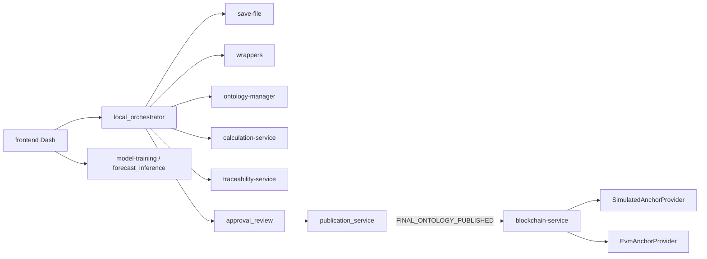

# Relatório completo — Auditoria Capítulo 5 (AgroTrace Carbon)

**Autor da dissertação:** Pedro Henrique Assis Silva  
**Instituição:** UFJF — PPGCC  
**Título:** Arquitetura Orientada ao Ciclo de Vida de Dados Agropecuários para Monitoramento, Relato e Verificação de Emissões de Gases de Efeito Estufa  
**Artefato:** terceiro ciclo (protótipo MRV agropecuário)  
**Data da auditoria:** 2026-08-03  
**Modo:** auditoria baseada em evidências (sem correção de código da aplicação)  
**Saídas irmãs:** `matriz-rastreabilidade.md`, `plano-evidencias.md`, `texto-base-capitulo-5.md`, `comandos-e-resultados.md`, `pendencias.md`

---

## 1. Identificação da versão analisada

| Campo | Valor |
|-------|-------|
| Caminho | `C:\Users\PedroAssis\Documents\agrotrace-carbon` |
| Controle de versão | **Ausente** (`git status` → `fatal: not a git repository`) |
| Identificação adotada | Inventário de arquivos + carimbo UTC do inventário (`_inventory_before.json`) + artefato Sepolia `20260731_153031` |
| Entrypoint UI | `frontend/main.py` |
| Python / venv | 3.11.9 (`.venv`) |
| Backup pré-execução | `%TEMP%\agrotrace-audit-backup-20260803-104947` (454 cycles + DBs) |

Não foi possível citar commit SHA. Qualquer republicação deste relatório deve repetir o inventário.

---

## 2. Data e ambiente da auditoria

- **SO:** Windows 10 (build 26200), PowerShell  
- **Ferramentas:** pytest 9.0.3; Foundry forge/anvil 1.7.1; Dash 4.1.0  
- **Rede EVM:** Sepolia **não** reancorada nesta sessão; Anvil **não** provisionado (`BLOCKCHAIN_ANVIL_PRIVATE_KEY` / `CONTRACT_ADDRESS` vazios)  
- **Escopo de execução acordado com o responsável:** testes + `validate_*` de leitura + e2e com ciclos **novos**; blockchain via artefatos Sepolia existentes + provider simulado + `forge test`

---

## 3. Escopo

### Incluído

- Frontend Dash (`main.py`, pages, callbacks, layout, components, assets)
- View services e adapters; `local_orchestrator`, `cycle_state`, `pipeline_display`
- Serviços: save-file, wrappers, ontology-manager, calculation, model-training, traceability, blockchain
- Contrato `CarbonEvidenceRegistry` e testes Foundry
- Scripts de validação/smoke documentados
- Artefatos Sepolia em `agrotrace-carbon-blockchain-service/evidence/sepolia/`
- Requisitos RF001–RF021, RNF001–RNF012, RN-01–RN-10, RE-01–RE-06

### Excluído / não modificado

- Correção de código da aplicação
- Reset destrutivo / aprovação em massa dos 454 ciclos
- Nova transação Sepolia / deploy Anvil
- Conteúdo de segredos (apenas existência/nomes de variáveis)
- Dependências de terceiros minificadas / venv / caches

---

## 4. Limitações

1. Sem Git → rastreio de versão frágil.  
2. Sem reexecução EVM ao vivo.  
3. `jsonschema` ausente → `test_anchor_payload_schema.py` não executado.  
4. Seed mensal dominante; Lot ausente na OWL.  
5. GET HTTP das rotas Dash valida shell (200), não cada widget pós-callback.  
6. Integridade criptográfica ≠ veracidade agropecuária.  
7. Dois DBs blockchain distintos (frontend vs serviço) — não misturar evidências.

---

## 5. Metodologia de análise

Etapas alinhadas ao prompt:

1. Verificação inicial (raiz, toolchain, docs, entrypoints)  
2. Mapeamento estrutural (frontend + 6 serviços)  
3. Normalização dos requisitos da dissertação  
4. Rastreabilidade requisito→implementação (imports/fluxos, não só nomes)  
5. Execução controlada (comandos registrados em `comandos-e-resultados.md`)  
6. Avaliação requisito a requisito com classificação conservadora  

**Regra central:** não presumir conformidade; preferir parcial / não verificável a afirmação sem prova; diferenciar requisito, critério inferido e recomendação complementar.

---

## 6. Mapa do repositório

```
agrotrace-carbon/
├── frontend/                          # UI Dash + orquestração
│   ├── main.py
│   ├── pages/ (8 rotas) + router.py
│   ├── callbacks/
│   ├── services/ (*_adapter, *_view_service, local_orchestrator, …)
│   ├── components/ + layout/ + assets/
│   ├── scripts/ (validate_*, smoke, e2e)
│   └── data/ (cycles, db, publications, evidence_packages, …)
├── agrotrace-carbon-save-file/
├── agrotrace-carbon-wrappers-service/
├── agrotrace-carbon-ontology-manager/
├── agrotrace-carbon-calculation-service/
├── agrotrace-carbon-model-training-service/
├── agrotrace-carbon-traceability-service/
├── agrotrace-carbon-blockchain-service/
│   ├── app/ (hexagonal)
│   ├── contracts/ (Foundry + CarbonEvidenceRegistry.sol)
│   └── evidence/sepolia/ (validações interativas)
└── docs/ (ADRs, architecture, audit, auditoria-capitulo-5/)
```

**Contagens aproximadas (código autoral filtrado):** ~680 `.py`, ~53 `.sol`, ~105 `.md` (inclui deps de contrato em `lib/` no total bruto de sol).

---

## 7. Arquitetura observada



**Pontos críticos confirmados:**

| Tema | Observação |
|------|------------|
| Integração | Direta Python (adapters); FastAPI do traceability é opcional e fora do contrato Dash |
| Gate | `can_unlock_blockchain` / `require_final_publication_event`; aliases `APPROVED_RESULT_PUBLISHED` ↔ `FINAL_ONTOLOGY_PUBLISHED` |
| Proveniência × blockchain | DBs e papéis separados; ancoragem só pós-publicação |
| Cálculo × predição | `/previsoes` separado; treino filtra approved/published |
| Idempotência | `idempotency_key = SHA-256(network_code:package_hash)`; `evidence_key = keccak256(package_id)` |
| Publicação | Acionada no fluxo de aprovação; `/final-publication` → `/approval` |

ADRs canônicos: `docs/decisions/ADR-001`, `ADR-002`, `ADR-003`.

---

## 8. Lista normalizada de requisitos

Ver prompt `PROMPT-AUDITORIA-CURSOR.md` (fonte) e classificações em §10 e em `matriz-rastreabilidade.md`.

Resumo quantitativo:

| Grupo | Atendido | Parcial | Não atendido | Não verificável |
|-------|----------|---------|--------------|-----------------|
| RF (21) | 15 | 6 | 0 | 0 |
| RNF (12) | 6 | 6 | 0 | 0 |
| RN (10) | 8 | 2 | 0 | 0 |
| RE (6) | 3 | 3 | 0 | 0 |
| **Total (49)** | **32 (65,3%)** | **17 (34,7%)** | **0** | **0** |

---

## 9. Matriz de rastreabilidade

Tabela completa: [`matriz-rastreabilidade.md`](matriz-rastreabilidade.md).

---

## 10. Análise detalhada por requisito

### 10.1 RF001–RF021 (síntese; detalhe expandido na matriz)

| ID | Status | Confiança | Síntese da evidência | Lacuna principal |
|----|--------|-----------|----------------------|------------------|
| RF001 | Atendido | alto | `/data-entry`; smoke upload; ciclos com contexto | — |
| RF002 | Parcial | alto | save + sha256; smoke | Sem retrieve API |
| RF003 | Atendido | alto | `process_file`; wrappers 41p | — |
| RF004 | Atendido | médio | validators + guards; smoke | Suite negativa dedicada |
| RF005 | Parcial | alto | layouts 3 gran.; Property/Animal | Sem Lot; daily seed |
| RF006 | Atendido | alto | ProvenanceRecorder; 104p; publisher pós-e2e | Link fraco com tx |
| RF007 | Atendido | alto | build/populate/export; ontology 14p | — |
| RF008 | Atendido | alto | compute_farm_period_emissions; preliminary | — |
| RF009 | Parcial | alto | method metadata | fatores/GWP flat; 1 FAIL review |
| RF010 | Parcial | médio | `request_correction` | histórico/cenário fraco |
| RF011 | Atendido | alto | treino approved/published; `/previsoes` | — |
| RF012 | Atendido | alto | dashboard indicators PASS | label property_filter |
| RF013 | Atendido | alto | ensure_review_started; fila | seed count 17 |
| RF014 | Atendido | alto | approve/reject; contagens e2e | — |
| RF015 | Atendido | alto | can_finalize/finalize | — |
| RF016 | Atendido | alto | run_publication_step; manifests | — |
| RF017 | Atendido | alto | EvidencePackageBuilder; 4 pacotes | schema test |
| RF018 | Atendido | alto | canonical+merkle; smoke íntegro; Sepolia tamper | — |
| RF019 | Atendido | alto | gate + simulado e2e; Sepolia artifact; forge | EVM Dash não reancorado |
| RF020 | Parcial | alto | 8 rotas HTTP 200 | 8≠12; painel colapsado |
| RF021 | Atendido | alto | verify smoke; Sepolia revalidação | — |

### 10.2 RNF001–RNF012

| ID | Status | Confiança | Lacuna / nota |
|----|--------|-----------|---------------|
| RNF001 | Parcial | alto | `audit_blockchain_anchor=0`; dois stores |
| RNF002 | Parcial | alto | TechnicalActionsPanel FAIL |
| RNF003 | Atendido | médio | Sem experimento de alteração |
| RNF004 | Atendido | alto | jsonschema ausente |
| RNF005 | Parcial | alto | fatores/GWP incompletos |
| RNF006 | Parcial | alto | Lot |
| RNF007 | Atendido | médio | 1 FAIL audit |
| RNF008 | Atendido | alto | — |
| RNF009 | Atendido | médio | double-run numérico fraco |
| RNF010 | Parcial | alto | ABI sem filename version |
| RNF011 | Atendido | alto | — |
| RNF012 | Parcial | médio | sem Git; varredura logs |

### 10.3 RN-01–RN-10

Atendidos: RN-01, RN-03, RN-04, RN-05, RN-06, RN-07, RN-08, RN-09, RN-10.  
Parciais: RN-02 (nomenclatura/estados), e reforço narrativo de RN-08 (duas chaves).

**Correção factual importante para a dissertação:** a chave `SHA-256(network_code:package_hash)` é a **idempotency_key**, não a `evidence_key` on-chain (`keccak256(evidence_package_id)`).

### 10.4 RE-01–RE-06 / CE1–CE5

| ID | Status | Nota |
|----|--------|------|
| RE-01/CE1 | Parcial | preparação ok; Lot/daily fracos |
| RE-02/CE2 | Atendido | smoke + full cycle |
| RE-03/CE3 | Atendido | forecast + filtro treino (confiança média) |
| RE-04/CE4 | Atendido | simulado + Sepolia artifact + forge |
| RE-05/CE5 | Parcial | 8 rotas ok; 1 FAIL painel; narrativa 12 telas |
| RE-06 | Parcial | matriz desta auditoria; falta fechar na dissertação |

Análise expandida por requisito (implementação, testes, recomendações): consolidada também nos rascunhos usados para montar a matriz e o texto-base; pendências em `pendencias.md`.

---

## 11. Comandos executados

Documento dedicado: [`comandos-e-resultados.md`](comandos-e-resultados.md).

Destaques: 328 testes passed (aprox.); 7/12 validates PASS; smoke PASS; full cycle PASS; forge 9 PASS; UI 8× HTTP 200; 454 cycles preservados.

---

## 12. Resultados dos testes

| Suite | Resultado |
|-------|-----------|
| ontology-manager | 14 passed |
| calculation-service | 43 passed |
| wrappers-service | 41 passed, 3 skipped |
| model-training | 50 passed |
| traceability-service | 104 passed |
| frontend/tests | 22 passed |
| save-file unittest | 4 passed |
| blockchain pytest (sem schema) | 41 passed, 4 deselected |
| blockchain schema test | **não executável** (`jsonschema` missing) |
| forge CarbonEvidenceRegistry | 9 passed |
| run_pipeline_smoke_test | PASS (VERIFICADO/ÍNTEGRO) |
| test_full_emission_cycle | PASS (incl. BLOCKCHAIN_LOCKED) |

Falhas de validação frontend (não bloqueiam o e2e, mas afetam CE1/CE5/RF009): pending_approval_seed, property_filter, temporal_model, calculation_review (1), technical_audit (1).

---

## 13. Análise técnica complementar

*(Não altera classificação acadêmica, salvo quando o próprio requisito exige a característica.)*

| Achado | Tipo | Nota |
|--------|------|------|
| Consolidação 8 rotas + redirects | (1)/(3) | Alinhar dissertação e rules Cursor |
| Dois DBs blockchain | (3) | Documentar qual caminho Dash usa |
| Fallback mock em adapters | (3) | UI tolera import failure — OK se explícito |
| TechnicalActionsPanel collapsed | (2) | Impede 100% RNF002/RF020 |
| factors_used annual | (2) | Impacta RF009 |
| `.env` com chave Sepolia SET | (1) RNF012 / (3) | Não expor; versionar ignore quando houver Git |
| HTTP FastAPI provenance :8080 | (4) | Fora do contrato Dash |
| WCAG/i18n/mobile | (4) | Não exigidos formalmente |
| Performance / bundle | (5) | Não medidos nesta auditoria |

---

## 14. Plano de screenshots

Documento dedicado: [`plano-evidencias.md`](plano-evidencias.md).  
Prioridade: RF001/002, RF008, RF013–016, RF017–021, RF011, RF012, RF020, Sepolia summary.

---

## 15. Riscos e lacunas

1. **Narrativa Cap. 5:** confundir SimulatedAnchorProvider (Dash/e2e) com Sepolia (artefato).  
2. **Granularidades:** risco de overclaim em Lot/daily.  
3. **Explicabilidade:** risco de afirmar recuperação completa de fatores/GWP.  
4. **Credenciais:** risco operacional por ausência de Git ignore verificável.  
5. **Seed vs scripts:** validates com expectativas fixas (17) quebram em ambiente povoado.  
6. **Alias de gate:** risco de inconsistência textual FINAL vs APPROVED_RESULT.

Pendências priorizadas: [`pendencias.md`](pendencias.md).

---

## 16. Recomendações priorizadas

1. **Alta:** retrieve do bruto (RF002); Lot ou revisão de escopo + seed daily (RF005); payload completo de parâmetros (RF009); corrigir painel auditoria + alinhar 8 telas (RF020); link proveniência→tx (RNF001).  
2. **Média:** cenário correção→recálculo (RF010); instalar `jsonschema`; versionar ABI; parametrizar seeds.  
3. **Baixa/Informativa:** glossário de aliases do gate; diagrama evidence_key vs idempotency_key; inicializar Git com `.env` ignorado.

---

## 17. Texto-base para o Capítulo 5

Documento dedicado: [`texto-base-capitulo-5.md`](texto-base-capitulo-5.md).

---

## 18. Checklist de revisão manual

| Item | Status |
|------|--------|
| Todos RF, RNF, RN, RE avaliados | Sim (49) |
| Status com justificativa | Sim (matriz + §10) |
| Conclusões com evidência | Sim (comandos + código + artefatos) |
| Caminhos/símbolos reais | Sim (verificados na exploração) |
| Comandos realmente executados | Sim (`comandos-e-resultados.md`) |
| Falhas não ocultadas | Sim (5 validates FAIL; jsonschema; seed) |
| Sem confusão frontend/serviços, proveniência/blockchain, cálculo/predição | Explicitado |
| Acadêmico ≠ complementar | Explicitado |
| Screenshots com roteiro | `plano-evidencias.md` |
| Texto Cap. 5 sem invenção | `texto-base-capitulo-5.md` |
| Segredos ocultados | Sim (apenas nomes SET/EMPTY) |
| Código da app não modificado | Sim — apenas `docs/auditoria-capitulo-5/` (+ `_inventory_before.json`) |
| 454 ciclos preservados | Sim (0 missing vs backup) |
| PROMPT não sobrescrito | Sim |

---

## Apêndice A — Rotas efetivas

```
/                 dashboard
/data-entry       data_entry
/calculations     emission_calculations
/approval         approval_review
/indicators       sustainability_indicators
/previsoes        forecasts
/technical-audit  technical_audit (9 abas)
/settings         settings
```

## Apêndice B — Artefato Sepolia de referência

`agrotrace-carbon-blockchain-service/evidence/sepolia/interactive_validation_20260731_153031/summary.json`  
`overall: SUCCESS`; `chain_id: 11155111`; `block_number: 11390296`; itens PASSOU incluem Gate final, Ancoragem/idempotência, Adulteração, Revalidação original.

## Apêndice C — Inventário before

Arquivo: `_inventory_before.json` (mesmo diretório).
